# 100マス計算 の つかいかた

このページは、100マス<ruby>計算<rt>けいさん</rt></ruby>を はじめて ひらく人の ための つかいかたです。
<ruby>画面<rt>がめん</rt></ruby>の <ruby>絵<rt>え</rt></ruby>と 見くらべながら、上から じゅんに <ruby>読<rt>よ</rt></ruby>んでください。

## 100マス<ruby>計算<rt>けいさん</rt></ruby>で できること（つかう人と <ruby>用意<rt>ようい</rt></ruby>する もの）

ここでは、この アプリで <ruby>何<rt>なに</rt></ruby>が できるのかと、はじめる まえに <ruby>用意<rt>ようい</rt></ruby>する ものを <ruby>説明<rt>せつめい</rt></ruby>します。

### 100マス<ruby>計算<rt>けいさん</rt></ruby>は どんな アプリ？

ブラウザで ひらくだけで つかえる、<ruby>計算<rt>けいさん</rt></ruby>の れんしゅう アプリです。
たし<ruby>算<rt>ざん</rt></ruby>・<ruby>引<rt>ひ</rt></ruby>き<ruby>算<rt>ざん</rt></ruby>・かけ<ruby>算<rt>ざん</rt></ruby>を、<ruby>時間<rt>じかん</rt></ruby>を はかりながら ときます。
アプリを ダウンロードしたり、ID や パスワードを つくったりする ひつようは ありません。

<ruby>時間<rt>じかん</rt></ruby>を <ruby>決<rt>き</rt></ruby>めて 「2<ruby>分<rt>ふん</rt></ruby>で <ruby>何問<rt>なんもん</rt></ruby> できるか」を ためしたり、かけ<ruby>算<rt>ざん</rt></ruby>で れんしゅうする だんを えらんだり する ことも できます。この 2つの やりかたは、この ページの さいごの 2つの <ruby>章<rt>しょう</rt></ruby>に <ruby>書<rt>か</rt></ruby>いてあります。

<ruby>名前<rt>なまえ</rt></ruby>も <ruby>出席番号<rt>しゅっせきばんごう</rt></ruby>も 入れません。1<ruby>回<rt>かい</rt></ruby> ひらいたあとは、インターネットに つながっていなくても つかえます。

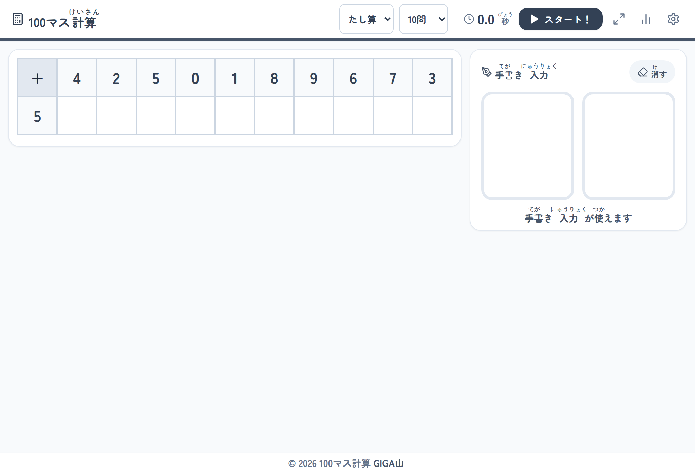

これが さいしょに 出る <ruby>画面<rt>がめん</rt></ruby>です。

### つかう人と、<ruby>用意<rt>ようい</rt></ruby>する もの

つかうのは <ruby>小学校<rt>しょうがっこう</rt></ruby>の 1<ruby>年生<rt>ねんせい</rt></ruby>から 6<ruby>年生<rt>ねんせい</rt></ruby>です。おうちの人や 先生と いっしょでも、ひとりでも つかえます。

<ruby>用意<rt>ようい</rt></ruby>する ものは、つぎの とおりです。

- タブレット か パソコン（Chromebook・iPad・Windows のどれでも つかえます）
- ブラウザ（Chrome・Safari・Edge のどれか）
- ひらく アドレス。 https://online-100square-calculation.giga-school.com/
- はじめて ひらく ときだけ、インターネットに つながる ところ。<ruby>手書<rt>てが</rt></ruby>きの <ruby>部品<rt>ぶひん</rt></ruby>も この ときに <ruby>取<rt>と</rt></ruby>りにいきます

ID・パスワード・メールアドレスは いりません。

### 出てくる <ruby>計算<rt>けいさん</rt></ruby>と、もんだいの <ruby>数<rt>かず</rt></ruby>

出てくる <ruby>計算<rt>けいさん</rt></ruby>は 3つです。

- たし<ruby>算<rt>ざん</rt></ruby>。0から9 に 0から9 を たします。<ruby>答<rt>こた</rt></ruby>えは 0から18 です
- <ruby>引<rt>ひ</rt></ruby>き<ruby>算<rt>ざん</rt></ruby>。10から19 から 0から9 を ひきます。<ruby>答<rt>こた</rt></ruby>えは 1から19 です
- かけ<ruby>算<rt>ざん</rt></ruby>。0から9 に 0から9 を かけます。九九と、0の だんが 出ます。<ruby>答<rt>こた</rt></ruby>えは 0から81 です

もんだいの <ruby>数<rt>かず</rt></ruby>は、10<ruby>問<rt>もん</rt></ruby>から 100<ruby>問<rt>もん</rt></ruby>まで、10<ruby>問<rt>もん</rt></ruby>ずつ えらべます。
10<ruby>問<rt>もん</rt></ruby>なら 1<ruby>行<rt>ぎょう</rt></ruby>、100<ruby>問<rt>もん</rt></ruby>なら 10<ruby>行<rt>ぎょう</rt></ruby>に なります。よこは いつも 10れつです。

上に ならぶ 10この <ruby>数<rt>かず</rt></ruby>は、<ruby>毎回<rt>まいかい</rt></ruby> 0から9 を まぜて ならべます。
左に ならぶ <ruby>数<rt>かず</rt></ruby>も、<ruby>毎回<rt>まいかい</rt></ruby> まぜて えらびます。おなじ <ruby>数<rt>かず</rt></ruby>が 2つの <ruby>行<rt>ぎょう</rt></ruby>に 出ることは ありません。
100<ruby>問<rt>もん</rt></ruby>に すると、左にも 0から9（<ruby>引<rt>ひ</rt></ruby>き<ruby>算<rt>ざん</rt></ruby>は 10から19）が 1<ruby>回<rt>かい</rt></ruby>ずつ 出ます。

【！】<ruby>覚<rt>おぼ</rt></ruby>えておいて ほしいこと:

- <ruby>数<rt>かず</rt></ruby>の ならびは <ruby>毎回<rt>まいかい</rt></ruby> つくり<ruby>直<rt>なお</rt></ruby>します。おなじ ばんめんを おぼえてしまう ことは ありません
- 100<ruby>問<rt>もん</rt></ruby>を やると、100とおりの <ruby>計算<rt>けいさん</rt></ruby>が 1<ruby>回<rt>かい</rt></ruby>ずつ 出ます。おなじ <ruby>式<rt>しき</rt></ruby>は 2<ruby>回<rt>かい</rt></ruby> 出ません

## はじめて ひらいたときに すること（さいしょの 1<ruby>回<rt>かい</rt></ruby>だけ）

ここに <ruby>書<rt>か</rt></ruby>いてあるのは、さいしょの 1<ruby>回<rt>かい</rt></ruby>だけ やることです。2<ruby>回目<rt>かいめ</rt></ruby>からは、アドレスを ひらくだけで はじめられます。

### ブラウザで アドレスを ひらく

1. Chrome か Safari か Edge を ひらいてください。
2. アドレスを 入れる ところに、上の アドレスを 入れて ひらいてください。
3. 「100マス<ruby>計算<rt>けいさん</rt></ruby>」と <ruby>書<rt>か</rt></ruby>いてある <ruby>画面<rt>がめん</rt></ruby>が 出たら、<ruby>準備<rt>じゅんび</rt></ruby>は できています。

先生から わたされた リンクや、<ruby>二次元<rt>にじげん</rt></ruby>コードから ひらいても <ruby>同<rt>おな</rt></ruby>じです。

### 【<ruby>重要<rt>じゅうよう</rt></ruby>】タブレットや パソコンに アプリとして 入れる

ホーム<ruby>画面<rt>がめん</rt></ruby>や デスクトップに 入れておくと、つぎからは アイコンから ひらけます。
インターネットに つながっていない ときも、アイコンから そのまま ひらけます。

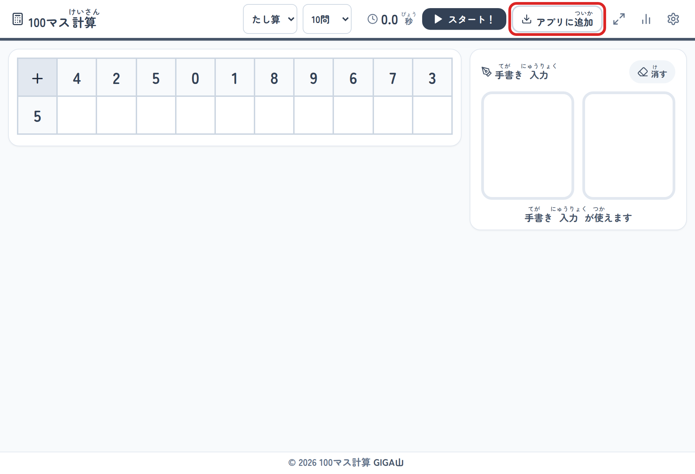

赤い わくの ボタンから 入れられます。

Chromebook・Windows で 入れる <ruby>手順<rt>てじゅん</rt></ruby>:

1. <ruby>画面<rt>がめん</rt></ruby>の 上に 「アプリに<ruby>追加<rt>ついか</rt></ruby>」の ボタンが 出たら、おしてください。
2. 「インストール」を おしてください。

ボタンが 出ないときは、アドレスを 入れる ところの 右はしに ある <ruby>丸<rt>まる</rt></ruby>い しるしか、
ブラウザの メニューの 「アプリをインストール」からでも 入れられます。

iPad・iPhone の Safari で 入れる <ruby>手順<rt>てじゅん</rt></ruby>:

1. <ruby>画面<rt>がめん</rt></ruby>の 下（または <ruby>右上<rt>みぎうえ</rt></ruby>）に ある <ruby>共有<rt>きょうゆう</rt></ruby>の ボタン（<ruby>四角<rt>しかく</rt></ruby>から 上に やじるしが 出た しるし）を おしてください。
2. メニューを 下に <ruby>送<rt>おく</rt></ruby>って、「ホーム<ruby>画面<rt>がめん</rt></ruby>に<ruby>追加<rt>ついか</rt></ruby>」を おしてください。
3. <ruby>右上<rt>みぎうえ</rt></ruby>の 「<ruby>追加<rt>ついか</rt></ruby>」を おしてください。

【！】<ruby>覚<rt>おぼ</rt></ruby>えておいて ほしいこと:

- 入れなくても つかえます。1<ruby>回<rt>かい</rt></ruby> ひらいた あとは、入れて いなくても、インターネットに つながっていない ところで つかえます。入れると はやく ひらけるように なります
- iPad は、7日 つかわないと 中の <ruby>記録<rt>きろく</rt></ruby>を <ruby>消<rt>け</rt></ruby>してしまうことが あります。ホーム<ruby>画面<rt>がめん</rt></ruby>に 入れておくと <ruby>消<rt>き</rt></ruby>えにくく なります
- すでに 入れてある ときは、「アプリに<ruby>追加<rt>ついか</rt></ruby>」の ボタンは 出ません

### <ruby>手書<rt>てが</rt></ruby>きを つかう人は、つながる ところで 1<ruby>回<rt>かい</rt></ruby> ひらいて たしかめる

<ruby>手書<rt>てが</rt></ruby>きの <ruby>読<rt>よ</rt></ruby>みとりに つかう <ruby>部品<rt>ぶひん</rt></ruby>は、アプリを ひらいた ときに、インターネットから <ruby>取<rt>と</rt></ruby>りにいきます。
<ruby>取<rt>と</rt></ruby>りおわると、<ruby>手書<rt>てが</rt></ruby>きの わくの 下に 「<ruby>手書<rt>てが</rt></ruby>き<ruby>入力<rt>にゅうりょく</rt></ruby>が<ruby>使<rt>つか</rt></ruby>えます」と 出ます。
ここまで 1<ruby>回<rt>かい</rt></ruby> 出れば、その <ruby>機械<rt>きかい</rt></ruby>の 中に のこるので、つぎからは つながっていなくても <ruby>手書<rt>てが</rt></ruby>きが つかえます。

みんなで つかう まえに、つながる ところで 1<ruby>回<rt>かい</rt></ruby> ひらいて、この <ruby>文字<rt>もじ</rt></ruby>が 出るのを たしかめておくと あんしんです。

<ruby>設定<rt>せってい</rt></ruby>で 「<ruby>手書<rt>てが</rt></ruby>き<ruby>入力<rt>にゅうりょく</rt></ruby>を<ruby>使<rt>つか</rt></ruby>う」を <ruby>切<rt>き</rt></ruby>って いる ときは、この <ruby>部品<rt>ぶひん</rt></ruby>を <ruby>取<rt>と</rt></ruby>りにいきません。

## <ruby>画面<rt>がめん</rt></ruby>の みかた（どこに <ruby>何<rt>なに</rt></ruby>が あるか）

<ruby>画面<rt>がめん</rt></ruby>は 3つの ところに <ruby>分<rt>わ</rt></ruby>かれています。どこに <ruby>何<rt>なに</rt></ruby>が あるかを 先に 見ておきましょう。

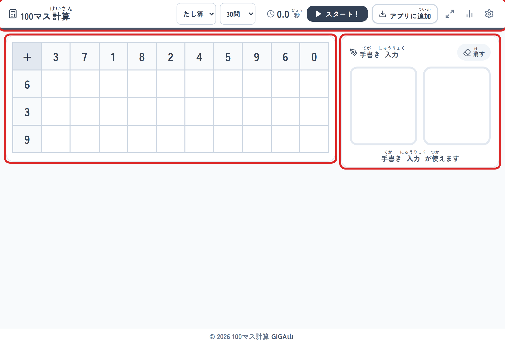

上の バー、まん中の ひょう、右の どうぐです。

### いちばん 上の バーに ある もの

<ruby>画面<rt>がめん</rt></ruby>の いちばん 上に ある よこながの バーに、えらぶ ところと ボタンが ならんでいます。
とりくんでいる あいだも、ここは ずっと 見えています。

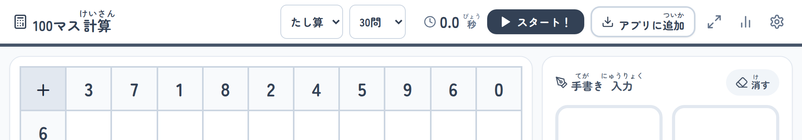

左から じゅんに ならんでいます。

上の バーには、左から つぎの ものが ならんでいます。

- 100マス<ruby>計算<rt>けいさん</rt></ruby>。この アプリの <ruby>名前<rt>なまえ</rt></ruby>です
- <ruby>計算<rt>けいさん</rt></ruby>の しゅるいを えらぶ ところ。たし<ruby>算<rt>ざん</rt></ruby>・<ruby>引<rt>ひ</rt></ruby>き<ruby>算<rt>ざん</rt></ruby>・かけ<ruby>算<rt>ざん</rt></ruby>
- もんだいの <ruby>数<rt>かず</rt></ruby>を えらぶ ところ。10<ruby>問<rt>もん</rt></ruby>から 100<ruby>問<rt>もん</rt></ruby>まで
- だんを えらぶ ボタン。かけ<ruby>算<rt>ざん</rt></ruby>を えらんだ ときだけ 出ます
- かかった <ruby>時間<rt>じかん</rt></ruby>。<ruby>秒<rt>びょう</rt></ruby>で 出ます。1<ruby>分<rt>ぷん</rt></ruby>を こえると 「2<ruby>分<rt>ふん</rt></ruby>5.3<ruby>秒<rt>びょう</rt></ruby>」の ように <ruby>分<rt>ふん</rt></ruby>と <ruby>秒<rt>びょう</rt></ruby>で 出ます
- スタート！。ここを おすと はじまります
- アプリに<ruby>追加<rt>ついか</rt></ruby>。この <ruby>機械<rt>きかい</rt></ruby>に 入れられる ときだけ 出ます
- 大きく<ruby>表示<rt>ひょうじ</rt></ruby>する。ななめの やじるしの しるしです。<ruby>画面<rt>がめん</rt></ruby>ぜんたいを 大きくします
- これまでの<ruby>記録<rt>きろく</rt></ruby>をみる。ぼうグラフの しるしです
- <ruby>設定<rt>せってい</rt></ruby>をひらく。はぐるまの しるしです

とりくんでいる あいだは、「スタート！」の ところが 「やめる」に かわります。
おわった あとは 「もう<ruby>一度<rt>いちど</rt></ruby>」に かわります。

<ruby>設定<rt>せってい</rt></ruby>で <ruby>時間<rt>じかん</rt></ruby>を <ruby>決<rt>き</rt></ruby>めて いる ときは、かかった <ruby>時間<rt>じかん</rt></ruby>の かわりに 「のこり」の <ruby>時間<rt>じかん</rt></ruby>が 出ます。「タイマーを かくす」を 入れて いる ときは、おわるまで <ruby>時間<rt>じかん</rt></ruby>は 出ません。

### まん中の マスの ひょう

まん中の 大きな ひょうが、<ruby>答<rt>こた</rt></ruby>えを 入れる ところです。
上の <ruby>数<rt>かず</rt></ruby>と 左の <ruby>数<rt>かず</rt></ruby>を 見て、そのマスに <ruby>答<rt>こた</rt></ruby>えを 入れます。

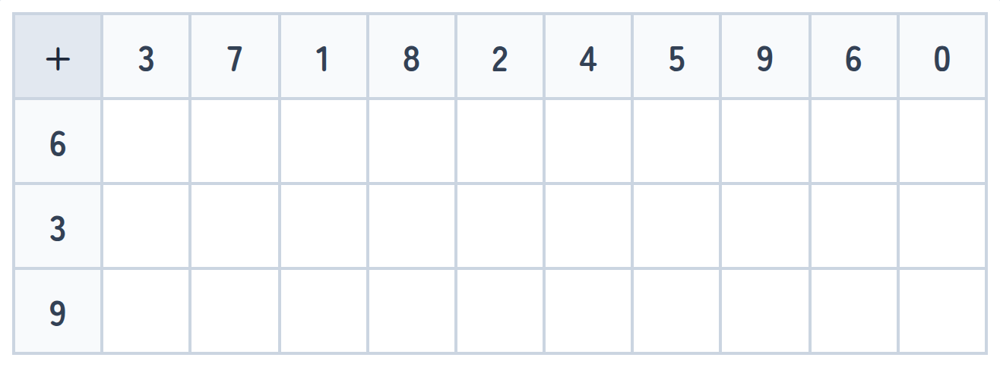

<ruby>左上<rt>ひだりうえ</rt></ruby>の しるしが、いまの <ruby>計算<rt>けいさん</rt></ruby>の しゅるいです。

ひょうの 見かたは つぎの とおりです。

- <ruby>左上<rt>ひだりうえ</rt></ruby>の しるし。たし<ruby>算<rt>ざん</rt></ruby>なら ＋、<ruby>引<rt>ひ</rt></ruby>き<ruby>算<rt>ざん</rt></ruby>なら −、かけ<ruby>算<rt>ざん</rt></ruby>なら × が 出ます
- 上の <ruby>行<rt>ぎょう</rt></ruby>の <ruby>数<rt>かず</rt></ruby>と、左の <ruby>列<rt>れつ</rt></ruby>の <ruby>数<rt>かず</rt></ruby>を 見て <ruby>計算<rt>けいさん</rt></ruby>します
- まん中の あいている ところが、<ruby>答<rt>こた</rt></ruby>えを 入れる マスです
- いま <ruby>答<rt>こた</rt></ruby>える マスには、こい わくが つきます

### <ruby>入力<rt>にゅうりょく</rt></ruby>どうぐ（<ruby>画面<rt>がめん</rt></ruby>の 右がわ、または ひょうの 下）

<ruby>答<rt>こた</rt></ruby>えを 入れる どうぐは、<ruby>画面<rt>がめん</rt></ruby>の はばが <ruby>広<rt>ひろ</rt></ruby>い とき（パソコンや、よこむきに した タブレット）は、ひょうの 右がわに 出ます。
はばが せまい とき（たてむきに した タブレットや スマートフォン、まどを せまく した パソコン）は、ひょうの 下に 出ます。

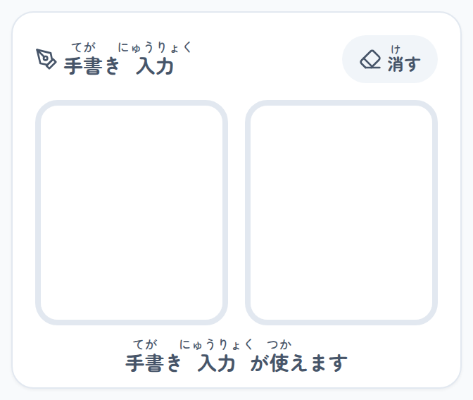

はじめは <ruby>手書<rt>てが</rt></ruby>き<ruby>入力<rt>にゅうりょく</rt></ruby>が 出ています。

- <ruby>手書<rt>てが</rt></ruby>き<ruby>入力<rt>にゅうりょく</rt></ruby>。<ruby>指<rt>ゆび</rt></ruby>や タッチペンで <ruby>数字<rt>すうじ</rt></ruby>を <ruby>書<rt>か</rt></ruby>いて 入れます
- ボタン<ruby>入力<rt>にゅうりょく</rt></ruby>。<ruby>画面<rt>がめん</rt></ruby>の <ruby>数字<rt>すうじ</rt></ruby>ボタンを おして 入れます
- <ruby>設定<rt>せってい</rt></ruby>で、どちらを 出すか、<ruby>両方<rt>りょうほう</rt></ruby> 出すかを えらべます
- <ruby>設定<rt>せってい</rt></ruby>で、右がわではなく 左がわに おくことも できます。ひょうの 下に 出て いる ときは、<ruby>設定<rt>せってい</rt></ruby>を かえても ばしょは かわりません

## <ruby>計算<rt>けいさん</rt></ruby>の しゅるいと もんだいの <ruby>数<rt>かず</rt></ruby>を えらんで はじめる

とりくんでいる あいだは えらべません。はじめる まえに えらんでください。

### たし<ruby>算<rt>ざん</rt></ruby>・<ruby>引<rt>ひ</rt></ruby>き<ruby>算<rt>ざん</rt></ruby>・かけ<ruby>算<rt>ざん</rt></ruby>を えらぶ

<ruby>計算<rt>けいさん</rt></ruby>の しゅるいは、上の バーの まん中あたりで えらびます。

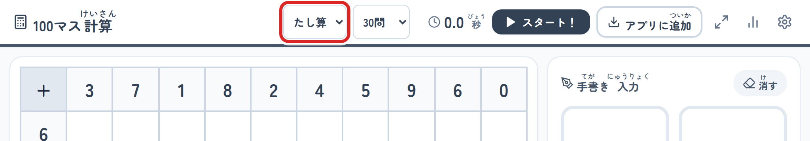

赤い わくの ところで えらびます。

1. 上の バーの 「たし<ruby>算<rt>ざん</rt></ruby>」と <ruby>書<rt>か</rt></ruby>いてある ところを おしてください。
2. 「たし<ruby>算<rt>ざん</rt></ruby>」「<ruby>引<rt>ひ</rt></ruby>き<ruby>算<rt>ざん</rt></ruby>」「かけ<ruby>算<rt>ざん</rt></ruby>」の 中から えらんでください。

えらぶと、ひょうの <ruby>数<rt>かず</rt></ruby>が すぐ 入れかわります。

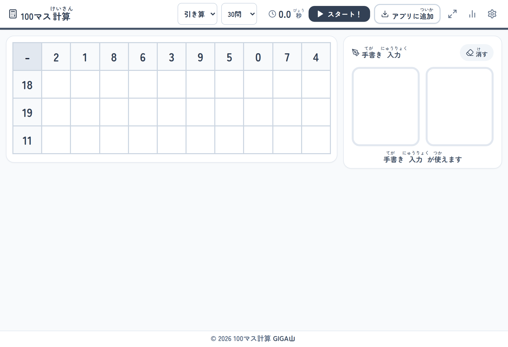

<ruby>引<rt>ひ</rt></ruby>き<ruby>算<rt>ざん</rt></ruby>では 左の <ruby>数<rt>かず</rt></ruby>が 10から19 に なります。

かけ<ruby>算<rt>ざん</rt></ruby>を えらぶと、もんだいの <ruby>数<rt>かず</rt></ruby>の 右どなりに 「だん: ぜんぶ」ボタンが 出ます。れんしゅうする だんを えらぶ ときに つかいます。えらびかたは 「かけ<ruby>算<rt>ざん</rt></ruby>で れんしゅうする だんを えらぶ」の <ruby>章<rt>しょう</rt></ruby>に <ruby>書<rt>か</rt></ruby>いてあります。

### もんだいの <ruby>数<rt>かず</rt></ruby>を えらぶ

もんだいの <ruby>数<rt>かず</rt></ruby>は、<ruby>計算<rt>けいさん</rt></ruby>の しゅるいの 右どなりで えらびます。

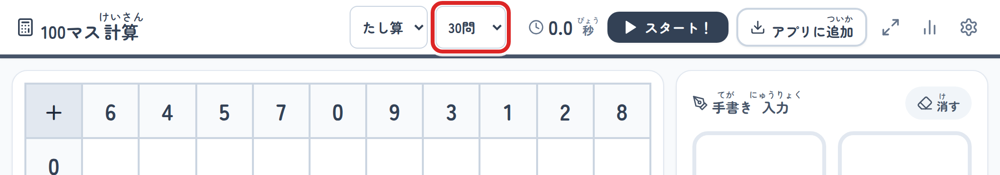

赤い わくの ところで えらびます。

1. 上の バーの 「10<ruby>問<rt>もん</rt></ruby>」と <ruby>書<rt>か</rt></ruby>いてある ところを おしてください。
2. 10<ruby>問<rt>もん</rt></ruby>から 100<ruby>問<rt>もん</rt></ruby>まで、10<ruby>問<rt>もん</rt></ruby>ずつ えらんでください。

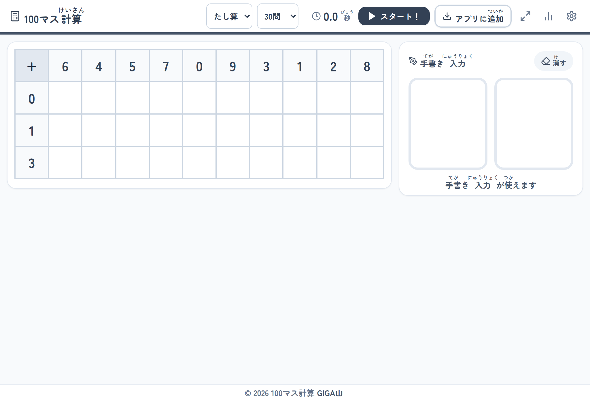

30<ruby>問<rt>もん</rt></ruby>に すると、<ruby>行<rt>ぎょう</rt></ruby>が 3つに なります。

はじめは 10<ruby>問<rt>もん</rt></ruby>か 20<ruby>問<rt>もん</rt></ruby>から やってみて、なれてきたら ふやすと よいです。

かけ<ruby>算<rt>ざん</rt></ruby>で だんを えらんで いる ときは、えらんだ だんの <ruby>数<rt>かず</rt></ruby>より <ruby>多<rt>おお</rt></ruby>い <ruby>行<rt>ぎょう</rt></ruby>は つくれないので、えらべる もんだいの <ruby>数<rt>かず</rt></ruby>が へります。

### 「スタート！」を おして はじめる

<ruby>計算<rt>けいさん</rt></ruby>の しゅるいと もんだいの <ruby>数<rt>かず</rt></ruby>を えらび おわったら、はじめます。

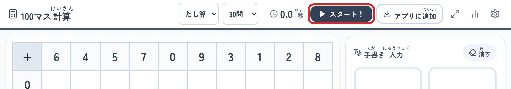

赤い わくの ボタンで はじまります。

1. 上の バーの 「スタート！」を おしてください。
2. <ruby>時間<rt>じかん</rt></ruby>が うごきだして、いちばん <ruby>左上<rt>ひだりうえ</rt></ruby>の マスが えらばれます。

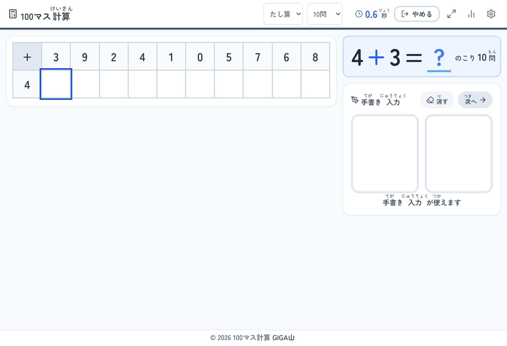

<ruby>時間<rt>じかん</rt></ruby>が うごきだしました。

【！】<ruby>覚<rt>おぼ</rt></ruby>えておいて ほしいこと:

- とりくんでいる あいだは、<ruby>計算<rt>けいさん</rt></ruby>の しゅるいも もんだいの <ruby>数<rt>かず</rt></ruby>も かえられません
- とちゅうで やめたい ときは、「やめる」を おします

### いま <ruby>答<rt>こた</rt></ruby>える <ruby>計算<rt>けいさん</rt></ruby>と、のこりの <ruby>数<rt>かず</rt></ruby>を 見る

とりくんでいる あいだ、<ruby>入力<rt>にゅうりょく</rt></ruby>どうぐの すぐ 上に 「いま とく <ruby>計算<rt>けいさん</rt></ruby>」が 出ます。
その 右には 「のこり <ruby>何問<rt>なんもん</rt></ruby>」かが 出ます。

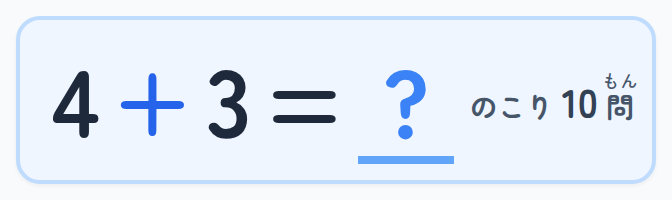

<ruby>式<rt>しき</rt></ruby>と、あと <ruby>何問<rt>なんもん</rt></ruby> のこっているかが 出ます。

ここを 見れば、ひょうから 目を はなさずに、いま <ruby>何<rt>なん</rt></ruby>の <ruby>計算<rt>けいさん</rt></ruby>を しているかが <ruby>分<rt>わ</rt></ruby>かります。

## <ruby>答<rt>こた</rt></ruby>えを <ruby>手書<rt>てが</rt></ruby>きで 入れる

はじめの <ruby>設定<rt>せってい</rt></ruby>では、<ruby>手書<rt>てが</rt></ruby>き<ruby>入力<rt>にゅうりょく</rt></ruby>が つかえるように なっています。

### <ruby>手書<rt>てが</rt></ruby>きの わくに <ruby>数字<rt>すうじ</rt></ruby>を <ruby>書<rt>か</rt></ruby>く

<ruby>手書<rt>てが</rt></ruby>きの わくは、<ruby>答<rt>こた</rt></ruby>えを 入れる ための 小さな ノートです。
ここに <ruby>書<rt>か</rt></ruby>いた <ruby>数字<rt>すうじ</rt></ruby>を、アプリが <ruby>読<rt>よ</rt></ruby>みとって マスに 入れます。
わくの <ruby>右上<rt>みぎうえ</rt></ruby>には 「<ruby>消<rt>け</rt></ruby>す」ボタンが あります。とりくんでいる あいだは、その 右に 「<ruby>次<rt>つぎ</rt></ruby>へ」ボタンも 出ます。

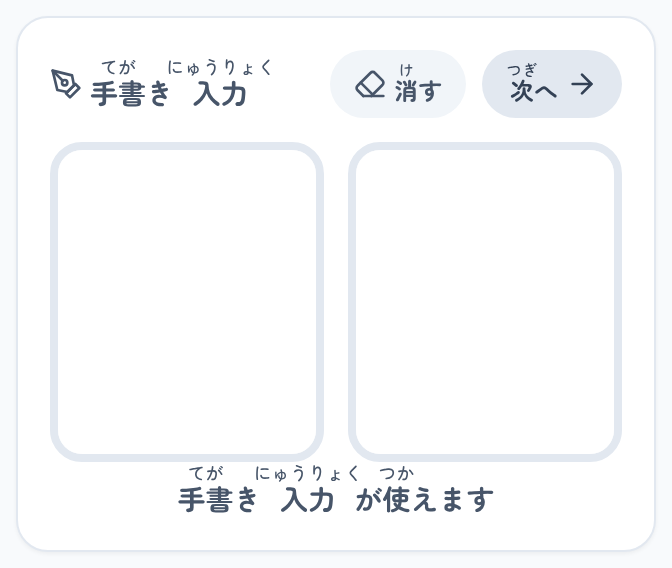

わくは 左と 右に 2つ あります。

<ruby>書<rt>か</rt></ruby>きかたの <ruby>手順<rt>てじゅん</rt></ruby>:

1. <ruby>答<rt>こた</rt></ruby>えを 入れたい マスを おして、こい わくを つけてください。
2. <ruby>手書<rt>てが</rt></ruby>きの わくの 中に、<ruby>指<rt>ゆび</rt></ruby>か タッチペンで 大きく <ruby>書<rt>か</rt></ruby>いてください。
3. <ruby>指<rt>ゆび</rt></ruby>を はなして 0.4<ruby>秒<rt>びょう</rt></ruby>ほど まつと、<ruby>読<rt>よ</rt></ruby>みとりが はしります。

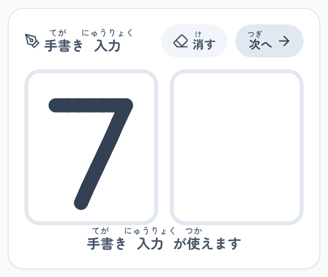

<ruby>書<rt>か</rt></ruby>いただけでは、まだ 入りません。

<ruby>読<rt>よ</rt></ruby>みとると、わくの 下に 「「7」を <ruby>入力<rt>にゅうりょく</rt></ruby>しました」のように 出て、マスに <ruby>数字<rt>すうじ</rt></ruby>が 入ります。
はじめの <ruby>設定<rt>せってい</rt></ruby>（すぐ<ruby>判定<rt>はんてい</rt></ruby>）では、<ruby>合<rt>あ</rt></ruby>って いれば、<ruby>書<rt>か</rt></ruby>いた <ruby>線<rt>せん</rt></ruby>が <ruby>消<rt>き</rt></ruby>えて つぎの マスへ うつるので、そのまま つづけて <ruby>書<rt>か</rt></ruby>けます。

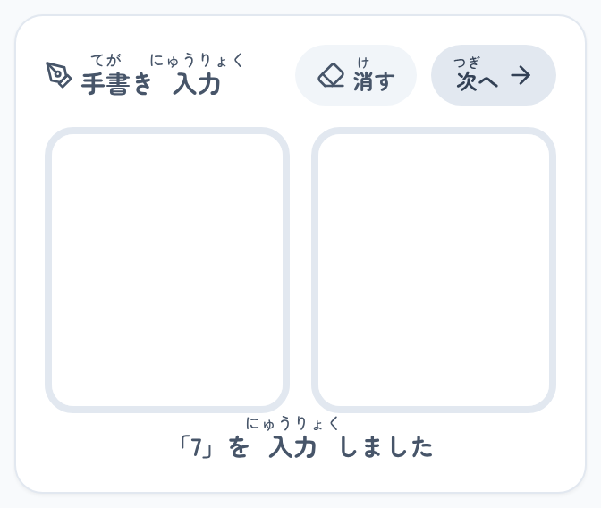

<ruby>線<rt>せん</rt></ruby>が <ruby>消<rt>き</rt></ruby>えて、下に <ruby>読<rt>よ</rt></ruby>みとった <ruby>数<rt>かず</rt></ruby>が 出ます。

### 2けたの <ruby>答<rt>こた</rt></ruby>えは、左と 右に 1つずつ <ruby>書<rt>か</rt></ruby>く

<ruby>答<rt>こた</rt></ruby>えが 2けた（10 から 81）の ときは、左の わくに 十のくらい、右の わくに 一のくらいを <ruby>書<rt>か</rt></ruby>きます。
1けたの ときは、<ruby>左右<rt>さゆう</rt></ruby>の どちらか かた<ruby>方<rt>ほう</rt></ruby>だけに <ruby>書<rt>か</rt></ruby>きます。

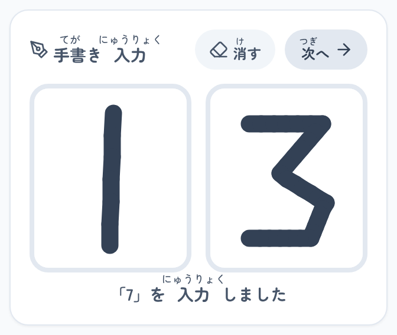

13 なら、左に 1、右に 3 を <ruby>書<rt>か</rt></ruby>きます。

### <ruby>書<rt>か</rt></ruby>きまちがえた ときに <ruby>消<rt>け</rt></ruby>して <ruby>書<rt>か</rt></ruby>き<ruby>直<rt>なお</rt></ruby>す

<ruby>書<rt>か</rt></ruby>きまちがえた ときは、<ruby>右上<rt>みぎうえ</rt></ruby>の 「<ruby>消<rt>け</rt></ruby>す」ボタンを おしてください。<ruby>左右<rt>さゆう</rt></ruby>の わくが <ruby>両方<rt>りょうほう</rt></ruby> <ruby>消<rt>き</rt></ruby>えます。

<ruby>読<rt>よ</rt></ruby>みとりが うまく いかなくて、ちがう <ruby>数<rt>かず</rt></ruby>が マスに 入って しまう ことも あります。
「すぐ<ruby>判定<rt>はんてい</rt></ruby>」を 入れて いる ときは、まちがいは その<ruby>場<rt>ば</rt></ruby>で <ruby>消<rt>き</rt></ruby>えるので、もう<ruby>一度<rt>いちど</rt></ruby> 大きく <ruby>書<rt>か</rt></ruby>いてください。
「すぐ<ruby>判定<rt>はんてい</rt></ruby>」を <ruby>切<rt>き</rt></ruby>って いる ときは、<ruby>手書<rt>てが</rt></ruby>きの わくの 「<ruby>消<rt>け</rt></ruby>す」を おしてから、もう<ruby>一度<rt>いちど</rt></ruby> <ruby>書<rt>か</rt></ruby>いてください。あたらしく <ruby>読<rt>よ</rt></ruby>みとった <ruby>数<rt>かず</rt></ruby>が、マスの <ruby>数<rt>かず</rt></ruby>と 入れかわります。

【！】<ruby>覚<rt>おぼ</rt></ruby>えておいて ほしいこと:

- <ruby>読<rt>よ</rt></ruby>みとりは、<ruby>指<rt>ゆび</rt></ruby>を はなして 0.4<ruby>秒<rt>びょう</rt></ruby>ほど たつと はしります。1つの <ruby>数字<rt>すうじ</rt></ruby>は、とちゅうで <ruby>止<rt>と</rt></ruby>まらずに <ruby>書<rt>か</rt></ruby>いてください。4 や 5 の ように 2<ruby>回<rt>かい</rt></ruby>に <ruby>分<rt>わ</rt></ruby>けて <ruby>書<rt>か</rt></ruby>く <ruby>数字<rt>すうじ</rt></ruby>で あいだが あくと、<ruby>書<rt>か</rt></ruby>きかけの まま <ruby>読<rt>よ</rt></ruby>みとられます
- <ruby>読<rt>よ</rt></ruby>みまちがいで ちがう <ruby>数<rt>かず</rt></ruby>が 入った ときも、<ruby>記録<rt>きろく</rt></ruby>では まちがいに <ruby>数<rt>かぞ</rt></ruby>えます
- マスの 中を おしても、<ruby>機械<rt>きかい</rt></ruby>の キーボードは 出てきません。<ruby>手書<rt>てが</rt></ruby>きの わくが かくれない ようにするためです
- うまく <ruby>読<rt>よ</rt></ruby>まれない ときは、わくいっぱいに 大きく、ふとく <ruby>書<rt>か</rt></ruby>いてください

## <ruby>答<rt>こた</rt></ruby>えを ボタンや キーボードで 入れる

<ruby>手書<rt>てが</rt></ruby>きが むずかしい ときや、はやさを きそう ときは、こちらが つかいやすいです。

### ボタン（テンキー）で 入れる

ボタン<ruby>入力<rt>にゅうりょく</rt></ruby>は、<ruby>設定<rt>せってい</rt></ruby>の 「ボタン<ruby>入力<rt>にゅうりょく</rt></ruby>を<ruby>使<rt>つか</rt></ruby>う」を 入れると 出てきます。
出しかたは 「<ruby>設定<rt>せってい</rt></ruby>で つかいごこちを かえる」の <ruby>章<rt>しょう</rt></ruby>に <ruby>書<rt>か</rt></ruby>いてあります。

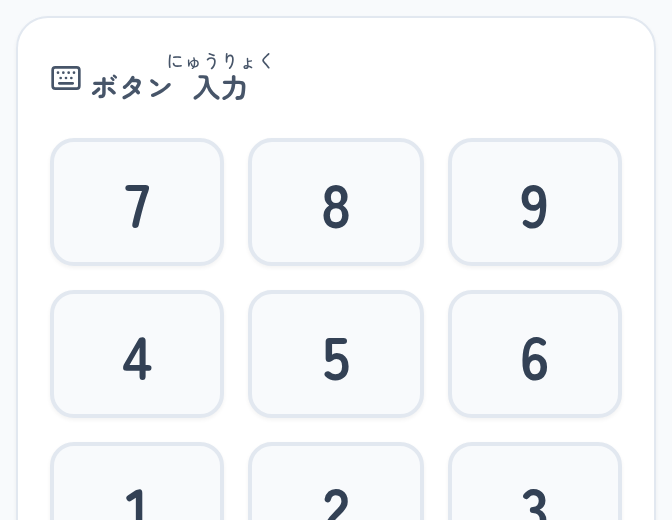

0から9 と、「<ruby>消<rt>け</rt></ruby>す」「<ruby>次<rt>つぎ</rt></ruby>へ」が あります。

- 0から9 の ボタン。おすと、いま えらんでいる マスに 入ります
- <ruby>消<rt>け</rt></ruby>す。さいごの 1<ruby>文字<rt>もじ</rt></ruby>を <ruby>消<rt>け</rt></ruby>します
- <ruby>次<rt>つぎ</rt></ruby>へ。つぎの マスへ すすみます

### キーボードで 入れる

Chromebook や パソコンでは、キーボードでも 入れられます。
<ruby>手書<rt>てが</rt></ruby>きや ボタンを つかう <ruby>設定<rt>せってい</rt></ruby>でも、キーボードは いっしょに つかえます。

- <ruby>数字<rt>すうじ</rt></ruby>の キー。その <ruby>数字<rt>すうじ</rt></ruby>が 入ります
- BackSpace。さいごの 1<ruby>文字<rt>もじ</rt></ruby>を <ruby>消<rt>け</rt></ruby>します
- Enter と 右やじるし。つぎの マスへ すすみます
- 左やじるし・上やじるし・下やじるし。その むきの マスへ うごけます。「すぐ<ruby>判定<rt>はんてい</rt></ruby>」を 入れて いる ときは、<ruby>正解<rt>せいかい</rt></ruby>した マスを とばして うごきます

### <ruby>合<rt>あ</rt></ruby>っていた とき・まちがえた ときに おきる こと

はじめの <ruby>設定<rt>せってい</rt></ruby>（すぐ<ruby>判定<rt>はんてい</rt></ruby>）では、<ruby>答<rt>こた</rt></ruby>えを 入れた その ときに <ruby>丸<rt>まる</rt></ruby>つけを します。

- <ruby>合<rt>あ</rt></ruby>っていた とき。音が <ruby>鳴<rt>な</rt></ruby>って、みどりの ふとい わくが つき、つぎの マスへ すすみます
- まちがえた とき。音が <ruby>鳴<rt>な</rt></ruby>って、入れた <ruby>数<rt>かず</rt></ruby>が <ruby>消<rt>き</rt></ruby>えます。もう<ruby>一度<rt>いちど</rt></ruby> 入れてください

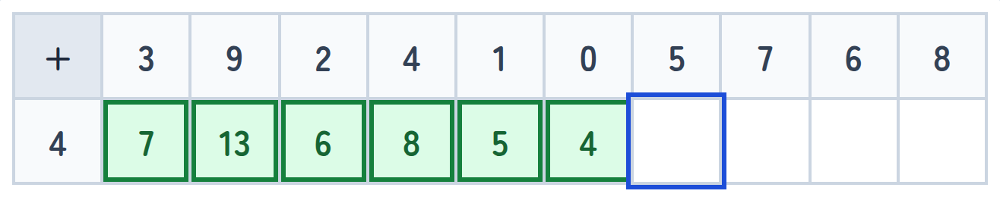

<ruby>合<rt>あ</rt></ruby>った マスは みどりの わくに なります。

【！】<ruby>覚<rt>おぼ</rt></ruby>えておいて ほしいこと:

- ぜんぶの マスが <ruby>合<rt>あ</rt></ruby>うまで おわりません。さいごまで やると ぜんぶ <ruby>正解<rt>せいかい</rt></ruby>に なります
- わからない マスは、とばして あとで もどれます。やりかたは、すぐ 下の 「わからない マスを とばして、あとで もどる」に <ruby>書<rt>か</rt></ruby>いてあります
- まちがえた ことは、<ruby>記録<rt>きろく</rt></ruby>の 中に のこります。あとで 見られます
- まちがいを のこしたまま すすめたい ときは、<ruby>設定<rt>せってい</rt></ruby>の 「すぐ<ruby>判定<rt>はんてい</rt></ruby>」を <ruby>切<rt>き</rt></ruby>ってください

### わからない マスを とばして、あとで もどる（「<ruby>次<rt>つぎ</rt></ruby>へ」）

<ruby>答<rt>こた</rt></ruby>えが すぐ 出ない マスは、<ruby>答<rt>こた</rt></ruby>えを 入れずに つぎの マスへ すすめます。とばしかたは 4つ あります。

- <ruby>手書<rt>てが</rt></ruby>きの わくの <ruby>右上<rt>みぎうえ</rt></ruby>に ある 「<ruby>次<rt>つぎ</rt></ruby>へ」を おす。とりくんでいる あいだだけ 出ます
- ボタン<ruby>入力<rt>にゅうりょく</rt></ruby>の 「<ruby>次<rt>つぎ</rt></ruby>へ」を おす
- キーボードの Enter か 右やじるしを おす
- べつの マスを <ruby>指<rt>ゆび</rt></ruby>で おす

ひょうの さいごの マスまで いくと、はじめに もどって、とばした マスへ うつります。
とばした マスも ぜんぶ <ruby>合<rt>あ</rt></ruby>うと、そこで おわります。

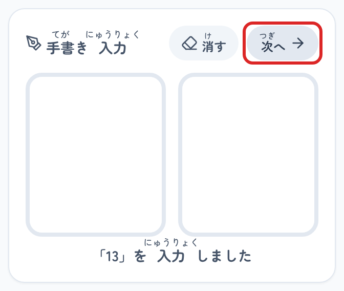

赤い わくの ボタンが 「<ruby>次<rt>つぎ</rt></ruby>へ」です。

【！】<ruby>覚<rt>おぼ</rt></ruby>えておいて ほしいこと:

- とばしても、まちがいには <ruby>数<rt>かぞ</rt></ruby>えません。<ruby>答<rt>こた</rt></ruby>えを 入れた ときだけ <ruby>数<rt>かぞ</rt></ruby>えます
- <ruby>正解<rt>せいかい</rt></ruby>した マスは、もう かえられません。「<ruby>次<rt>つぎ</rt></ruby>へ」も やじるしも、<ruby>正解<rt>せいかい</rt></ruby>した マスを とばして うごきます

## とちゅうで やめる・おわったら <ruby>結果<rt>けっか</rt></ruby>を 見る

さいごまで できた ときも、とちゅうで やめた ときも、<ruby>記録<rt>きろく</rt></ruby>は のこります。

### とちゅうで やめる

1. 上の バーの 「やめる」を おしてください。
2. たしかめる まどが 出ます。

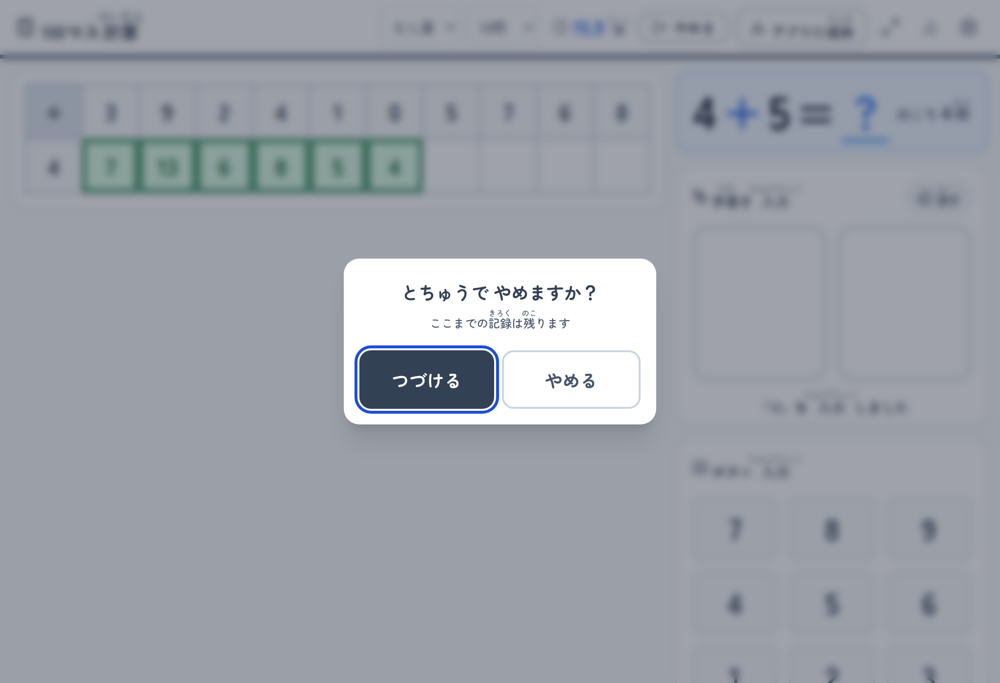

「つづける」か「やめる」を えらびます。

3. やめる ときは 「やめる」を、つづける ときは 「つづける」を おしてください。

【！】<ruby>覚<rt>おぼ</rt></ruby>えておいて ほしいこと:

- とちゅうで やめても、そこまでの <ruby>記録<rt>きろく</rt></ruby>は のこります。ただし、<ruby>答<rt>こた</rt></ruby>えを 1つも 入れて いない ときは のこりません
- 「とちゅうでやめた<ruby>回数<rt>かいすう</rt></ruby>」として <ruby>記録<rt>きろく</rt></ruby>に 出ます。むずかしすぎた しるしなので、はずかしい ことでは ありません
- ほかの <ruby>画面<rt>がめん</rt></ruby>を 見たまま 5<ruby>分<rt>ぷん</rt></ruby> もどらなかった ときも、とちゅうで やめた ことに なります

### ぜんぶ できた ときの <ruby>結果<rt>けっか</rt></ruby>

とりくみが おわると、<ruby>時間<rt>じかん</rt></ruby>が <ruby>止<rt>と</rt></ruby>まって、上に <ruby>結果<rt>けっか</rt></ruby>が 出ます。

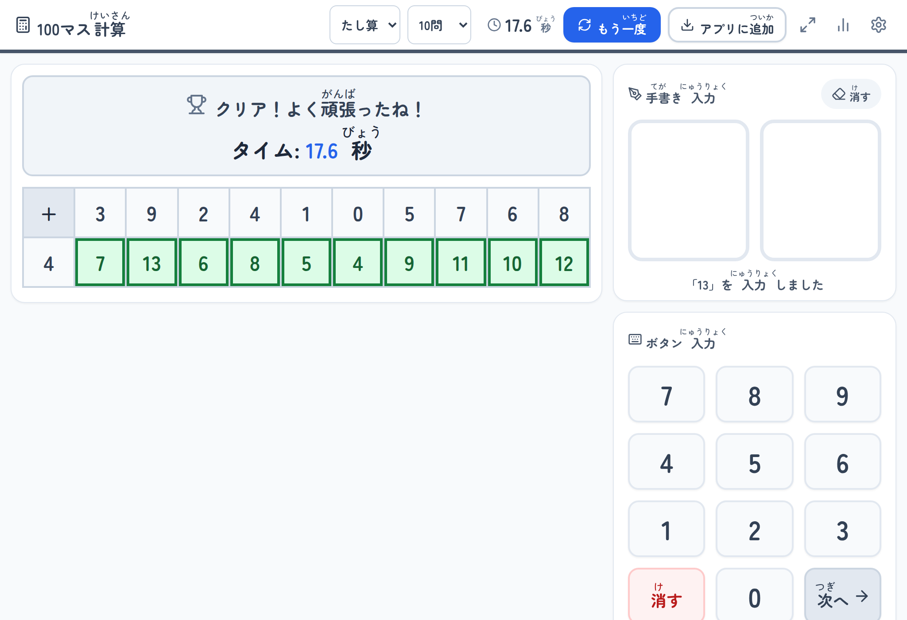

かかった <ruby>時間<rt>じかん</rt></ruby>が 大きく 出ます。

- ぜんぶ <ruby>正解<rt>せいかい</rt></ruby>の とき。「クリア！よく<ruby>頑張<rt>がんば</rt></ruby>ったね！」と 出ます
- <ruby>正解<rt>せいかい</rt></ruby>できなかった マスが ある とき。「おわり！<ruby>正解<rt>せいかい</rt></ruby> <ruby>何問<rt>なんもん</rt></ruby>」と 出ます
- <ruby>決<rt>き</rt></ruby>めた <ruby>時間<rt>じかん</rt></ruby>に なって おわった とき。「<ruby>時間<rt>じかん</rt></ruby>です！よく<ruby>頑張<rt>がんば</rt></ruby>ったね！」と 出ます

かかった <ruby>時間<rt>じかん</rt></ruby>が 1<ruby>分<rt>ぷん</rt></ruby>を こえた ときは、「2<ruby>分<rt>ふん</rt></ruby>5.3<ruby>秒<rt>びょう</rt></ruby>」の ように、<ruby>分<rt>ふん</rt></ruby>と <ruby>秒<rt>びょう</rt></ruby>で 出ます。

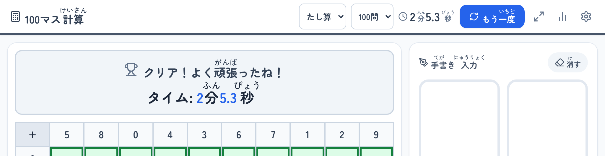

上の バーにも <ruby>結果<rt>けっか</rt></ruby>にも、2<ruby>分<rt>ふん</rt></ruby>5.3<ruby>秒<rt>びょう</rt></ruby>と 出て います。

### もう<ruby>一度<rt>いちど</rt></ruby> やる（あたらしい ならびで やり<ruby>直<rt>なお</rt></ruby>す）

<ruby>結果<rt>けっか</rt></ruby>が 出ると、上の バーの ボタンが 「もう<ruby>一度<rt>いちど</rt></ruby>」に かわります。
おすと、あたらしい ならびの ひょうが 出て、はじめから やり<ruby>直<rt>なお</rt></ruby>せます。

<ruby>計算<rt>けいさん</rt></ruby>の しゅるいや もんだいの <ruby>数<rt>かず</rt></ruby>を かえたい ときは、「もう<ruby>一度<rt>いちど</rt></ruby>」を おさなくても、<ruby>結果<rt>けっか</rt></ruby>が 出て いる <ruby>画面<rt>がめん</rt></ruby>で そのまま えらべます。えらぶと、あたらしい ひょうに かわります。

## <ruby>設定<rt>せってい</rt></ruby>で つかいごこちを かえる（音・<ruby>入力<rt>にゅうりょく</rt></ruby>・<ruby>丸<rt>まる</rt></ruby>つけ）

<ruby>設定<rt>せってい</rt></ruby>は この <ruby>機械<rt>きかい</rt></ruby>の 中に のこります。つぎに ひらいた ときも、<ruby>前<rt>まえ</rt></ruby>の ままです。

### <ruby>設定<rt>せってい</rt></ruby>の <ruby>画面<rt>がめん</rt></ruby>を ひらく

1. 上の バーの 右はしに ある はぐるまの しるしを おしてください。
2. <ruby>設定<rt>せってい</rt></ruby>の まどが 出ます。

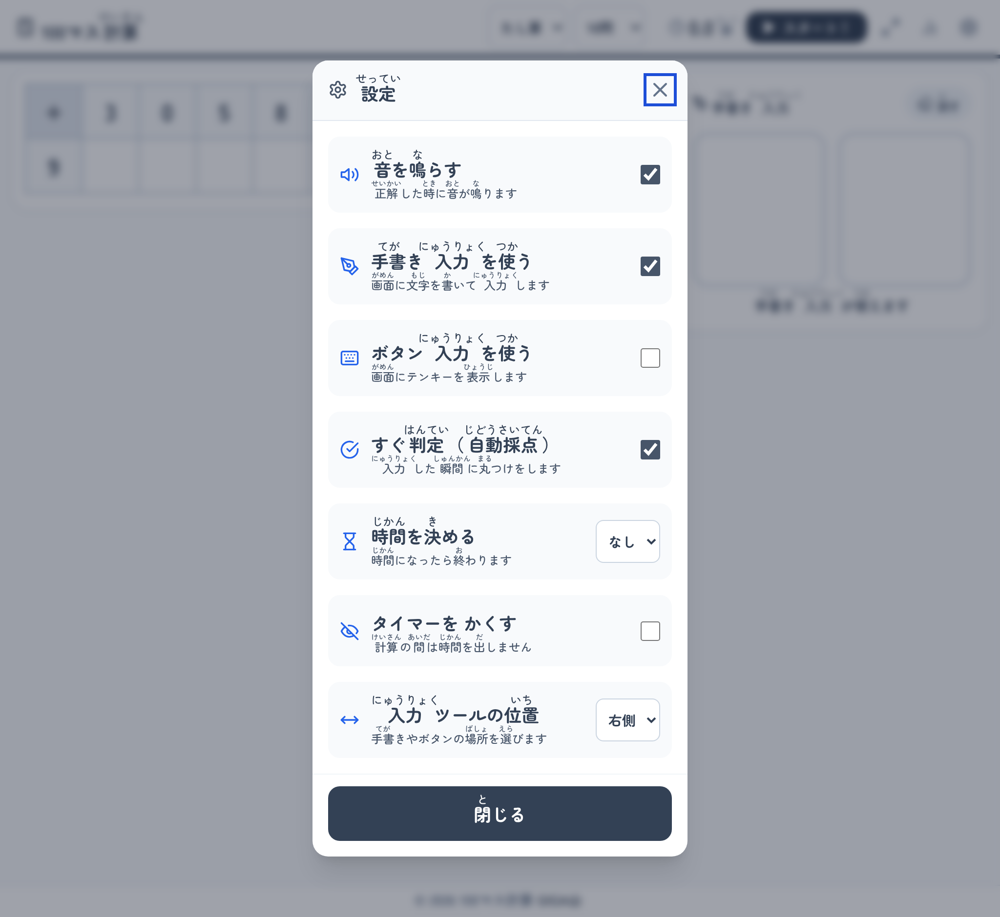

7つの ことを かえられます。

3. かえおわったら、下の 「<ruby>閉<rt>と</rt></ruby>じる」を おしてください。

<ruby>設定<rt>せってい</rt></ruby>の まどには、上から つぎの 7つが ならんでいます。

- 音を<ruby>鳴<rt>な</rt></ruby>らす
- <ruby>手書<rt>てが</rt></ruby>き<ruby>入力<rt>にゅうりょく</rt></ruby>を<ruby>使<rt>つか</rt></ruby>う
- ボタン<ruby>入力<rt>にゅうりょく</rt></ruby>を<ruby>使<rt>つか</rt></ruby>う
- すぐ<ruby>判定<rt>はんてい</rt></ruby>（<ruby>自動採点<rt>じどうさいてん</rt></ruby>）
- <ruby>時間<rt>じかん</rt></ruby>を<ruby>決<rt>き</rt></ruby>める
- タイマーを かくす
- <ruby>入力<rt>にゅうりょく</rt></ruby>ツールの<ruby>位置<rt>いち</rt></ruby>

【！】<ruby>覚<rt>おぼ</rt></ruby>えておいて ほしいこと:

- ならんで いる ものが <ruby>多<rt>おお</rt></ruby>いので、<ruby>画面<rt>がめん</rt></ruby>の たかさが ひくい ときは、いちどに ぜんぶは 見えません。まどの 中を <ruby>指<rt>ゆび</rt></ruby>で 上に うごかすと、下の ほうが 出てきます
- 「<ruby>時間<rt>じかん</rt></ruby>を<ruby>決<rt>き</rt></ruby>める」と 「タイマーを かくす」の つかいかたは、「<ruby>時間<rt>じかん</rt></ruby>を <ruby>決<rt>き</rt></ruby>めて とりくむ・タイマーを かくす」の <ruby>章<rt>しょう</rt></ruby>に <ruby>書<rt>か</rt></ruby>いてあります

### 音を <ruby>鳴<rt>な</rt></ruby>らす／音を <ruby>消<rt>け</rt></ruby>す

「音を<ruby>鳴<rt>な</rt></ruby>らす」を 入れると、<ruby>正解<rt>せいかい</rt></ruby>した とき、まちがえた とき、おわった ときに 音が <ruby>鳴<rt>な</rt></ruby>ります。
<ruby>切<rt>き</rt></ruby>ると、音は <ruby>鳴<rt>な</rt></ruby>りません。

音に びっくりしてしまう 人が いる ときや、みんなで しずかに とりくむ ときは、<ruby>切<rt>き</rt></ruby>ってください。

### <ruby>手書<rt>てが</rt></ruby>き<ruby>入力<rt>にゅうりょく</rt></ruby>・ボタン<ruby>入力<rt>にゅうりょく</rt></ruby>を つかうか きめる

「<ruby>手書<rt>てが</rt></ruby>き<ruby>入力<rt>にゅうりょく</rt></ruby>を<ruby>使<rt>つか</rt></ruby>う」と「ボタン<ruby>入力<rt>にゅうりょく</rt></ruby>を<ruby>使<rt>つか</rt></ruby>う」は、どちらも 入れたり <ruby>切<rt>き</rt></ruby>ったり できます。
<ruby>両方<rt>りょうほう</rt></ruby> 入れると、<ruby>手書<rt>てが</rt></ruby>きの わくと ボタンが <ruby>両方<rt>りょうほう</rt></ruby> 出ます。

<ruby>手書<rt>てが</rt></ruby>きを つかわない ときは <ruby>切<rt>き</rt></ruby>ってください。<ruby>読<rt>よ</rt></ruby>みとりの <ruby>部品<rt>ぶひん</rt></ruby>も <ruby>取<rt>と</rt></ruby>りにいかなくなります。

<ruby>両方<rt>りょうほう</rt></ruby> <ruby>切<rt>き</rt></ruby>ると、マスを おした ときに <ruby>機械<rt>きかい</rt></ruby>の キーボードが 出るように なります。

### <ruby>入力<rt>にゅうりょく</rt></ruby>どうぐを 右か 左に おく

「<ruby>入力<rt>にゅうりょく</rt></ruby>ツールの<ruby>位置<rt>いち</rt></ruby>」で、<ruby>手書<rt>てが</rt></ruby>きや ボタンを <ruby>画面<rt>がめん</rt></ruby>の 右に おくか 左に おくかを えらべます。
この <ruby>設定<rt>せってい</rt></ruby>が きくのは、<ruby>画面<rt>がめん</rt></ruby>の はばが <ruby>広<rt>ひろ</rt></ruby>くて、どうぐが ひょうの よこに 出て いる ときだけです。はばが せまくて ひょうの 下に 出て いる ときは、えらんでも ばしょは かわりません。

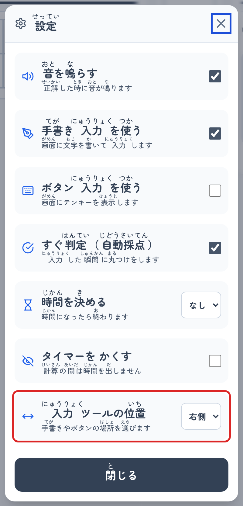

赤い わくの ところで えらびます。

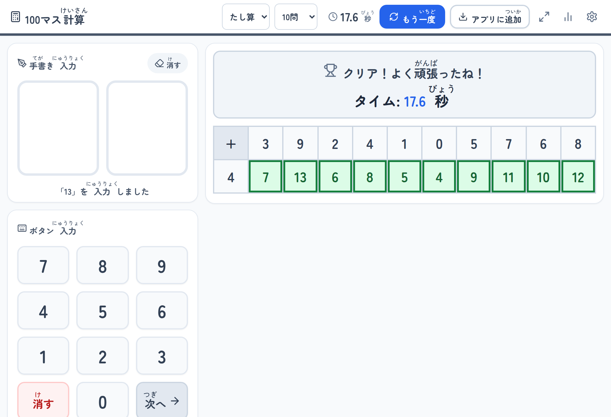

左ききの 人は、こちらが <ruby>書<rt>か</rt></ruby>きやすいです。

### すぐ<ruby>判定<rt>はんてい</rt></ruby>（<ruby>自動採点<rt>じどうさいてん</rt></ruby>）を <ruby>切<rt>き</rt></ruby>って、あとで まとめて <ruby>丸<rt>まる</rt></ruby>つけする

「すぐ<ruby>判定<rt>はんてい</rt></ruby>」を 入れて いる ときは、<ruby>答<rt>こた</rt></ruby>えを 入れた その ときに <ruby>丸<rt>まる</rt></ruby>つけを します。
<ruby>切<rt>き</rt></ruby>ると、<ruby>紙<rt>かみ</rt></ruby>の テストと <ruby>同<rt>おな</rt></ruby>じように、さいごまで <ruby>自分<rt>じぶん</rt></ruby>で といてから <ruby>答<rt>こた</rt></ruby>え<ruby>合<rt>あ</rt></ruby>わせを する ことに なります。

<ruby>切<rt>き</rt></ruby>ったときに かわる ことは、つぎの とおりです。

- まちがえても 入れた <ruby>数<rt>かず</rt></ruby>は <ruby>消<rt>き</rt></ruby>えません。そのまま のこります
- とちゅうでは みどりや 赤の しるしが つきません。<ruby>正解<rt>せいかい</rt></ruby>や まちがいの 音も <ruby>鳴<rt>な</rt></ruby>りません
- 「のこり <ruby>何問<rt>なんもん</rt></ruby>」は、まだ 入れていない マスの <ruby>数<rt>かず</rt></ruby>に なります
- <ruby>答<rt>こた</rt></ruby>えを 入れても、つぎの マスへは うつりません。<ruby>手書<rt>てが</rt></ruby>きの わくや ボタン<ruby>入力<rt>にゅうりょく</rt></ruby>の 「<ruby>次<rt>つぎ</rt></ruby>へ」、Enter、右やじるしで、<ruby>自分<rt>じぶん</rt></ruby>で すすみます。つぎの マスを おしても うつれます
- <ruby>入力<rt>にゅうりょく</rt></ruby>どうぐの すぐ 上（「いま とく <ruby>計算<rt>けいさん</rt></ruby>」の 下）に、「<ruby>丸<rt>まる</rt></ruby>つけ する」ボタンが 出ます
- ぜんぶの マスが うまると、じどうで <ruby>丸<rt>まる</rt></ruby>つけが はじまります

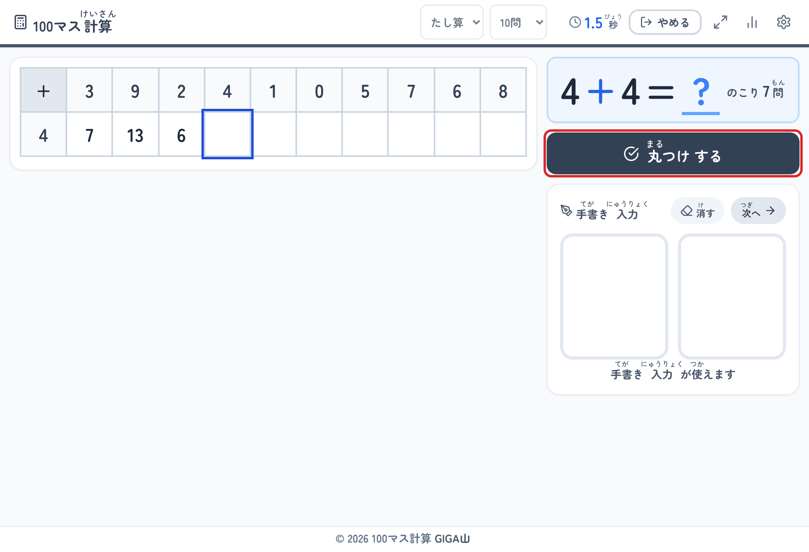

赤い わくの ボタンが 「<ruby>丸<rt>まる</rt></ruby>つけ する」です。

ぜんぶ うめても <ruby>丸<rt>まる</rt></ruby>つけが はじまらない ことが あります。<ruby>答<rt>こた</rt></ruby>えが 2けたの マスに、さいごに 1けたの <ruby>数<rt>かず</rt></ruby>を 入れた ときです。
その ときは、「<ruby>丸<rt>まる</rt></ruby>つけ する」を おしてください。

あいている マスが のこって いる ときに 「<ruby>丸<rt>まる</rt></ruby>つけ する」を おすと、「<ruby>丸<rt>まる</rt></ruby>つけ しますか？」「まだ 7マス あいています」のように たしかめる まどが 出ます。
つづける ときは 「つづける」を、そこで おわりに する ときは 「<ruby>丸<rt>まる</rt></ruby>つけ する」を おしてください。

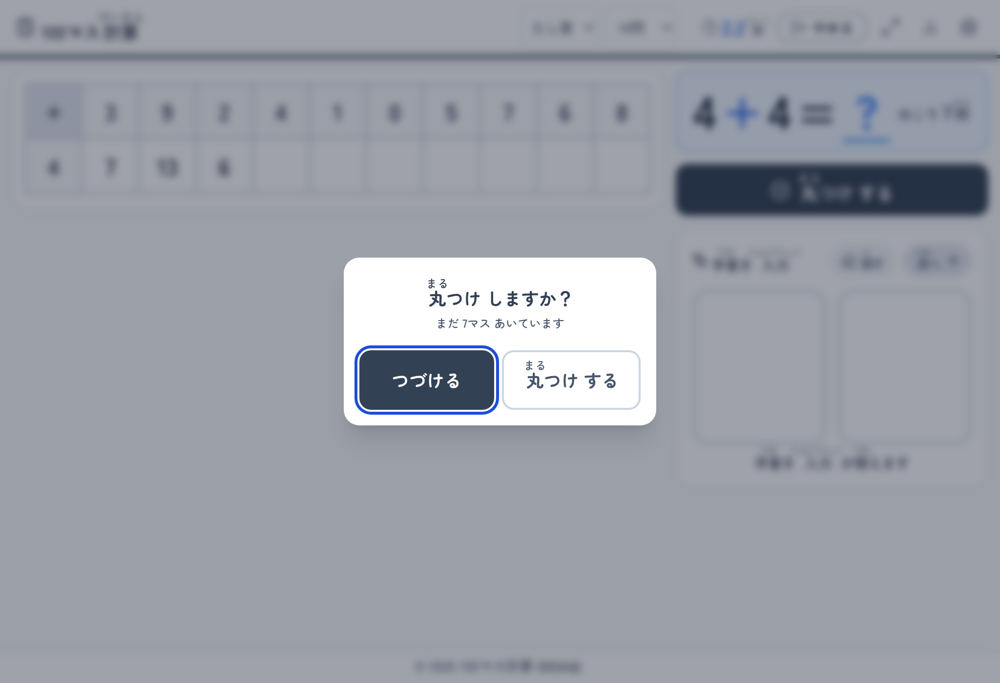

「つづける」か 「<ruby>丸<rt>まる</rt></ruby>つけ する」を えらびます。

<ruby>手書<rt>てが</rt></ruby>きで <ruby>答<rt>こた</rt></ruby>えを <ruby>書<rt>か</rt></ruby>き<ruby>直<rt>なお</rt></ruby>したい ときは、<ruby>手書<rt>てが</rt></ruby>きの わくの 「<ruby>消<rt>け</rt></ruby>す」を おしてから、もう<ruby>一度<rt>いちど</rt></ruby> <ruby>書<rt>か</rt></ruby>きます。あたらしく <ruby>読<rt>よ</rt></ruby>みとった <ruby>数<rt>かず</rt></ruby>が、マスの <ruby>数<rt>かず</rt></ruby>と 入れかわります。

おわると、<ruby>正解<rt>せいかい</rt></ruby>と まちがいが まとめて 出ます。

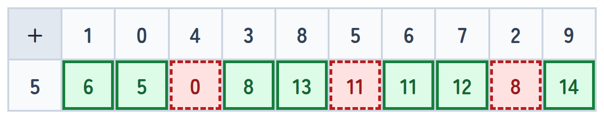

<ruby>正解<rt>せいかい</rt></ruby>は <ruby>実線<rt>じっせん</rt></ruby>の わく、まちがいは <ruby>点線<rt>てんせん</rt></ruby>の わくです。

【！】<ruby>覚<rt>おぼ</rt></ruby>えておいて ほしいこと:

- <ruby>丸<rt>まる</rt></ruby>つけは、ぜんぶの マスが うまった ときか、「<ruby>丸<rt>まる</rt></ruby>つけ する」を おした ときに 出ます
- <ruby>色<rt>いろ</rt></ruby>が <ruby>見分<rt>みわ</rt></ruby>けにくい 人にも <ruby>分<rt>わ</rt></ruby>かるように、わくの <ruby>線<rt>せん</rt></ruby>の かたちでも <ruby>分<rt>わ</rt></ruby>けています
- まちがいを のこしたまま おわった <ruby>回<rt>かい</rt></ruby>は、ベストタイムにも 「<ruby>最近<rt>さいきん</rt></ruby>の<ruby>記録<rt>きろく</rt></ruby>」にも 出ません。ぜんぶ <ruby>正解<rt>せいかい</rt></ruby>で おわれば 出ます

## これまでの <ruby>記録<rt>きろく</rt></ruby>を 見る

<ruby>記録<rt>きろく</rt></ruby>は、とりくむ たびに ふえていきます。

### <ruby>記録<rt>きろく</rt></ruby>の <ruby>画面<rt>がめん</rt></ruby>を ひらく

1. 上の バーの ぼうグラフの しるしを おしてください。
2. <ruby>記録<rt>きろく</rt></ruby>の まどが 出ます。

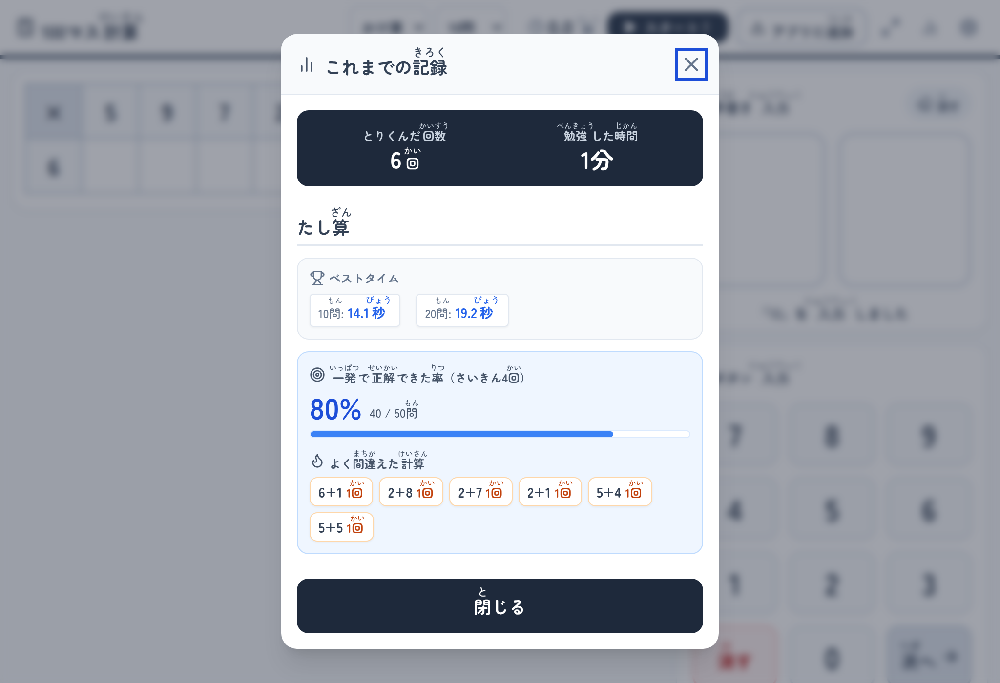

上に ぜんたい、下に <ruby>計算<rt>けいさん</rt></ruby>ごとの <ruby>記録<rt>きろく</rt></ruby>が 出ます。

3. 見おわったら、下の 「<ruby>閉<rt>と</rt></ruby>じる」を おしてください。

### とりくんだ <ruby>回数<rt>かいすう</rt></ruby>と、<ruby>勉強<rt>べんきょう</rt></ruby>した <ruby>時間<rt>じかん</rt></ruby>

いちばん 上の くろい ところに、3つの <ruby>計算<rt>けいさん</rt></ruby>を あわせた 「とりくんだ<ruby>回数<rt>かいすう</rt></ruby>」と 「<ruby>勉強<rt>べんきょう</rt></ruby>した<ruby>時間<rt>じかん</rt></ruby>」が 出ます。

「<ruby>勉強<rt>べんきょう</rt></ruby>した<ruby>時間<rt>じかん</rt></ruby>」は、1<ruby>分<rt>ぷん</rt></ruby>ほど <ruby>何<rt>なに</rt></ruby>も していないと <ruby>数<rt>かぞ</rt></ruby>えるのを <ruby>止<rt>と</rt></ruby>めます。
ほかの <ruby>画面<rt>がめん</rt></ruby>を 見ている あいだも <ruby>数<rt>かぞ</rt></ruby>えません。ひらいたままに していた <ruby>時間<rt>じかん</rt></ruby>は 入りません。

### ベストタイムと <ruby>最近<rt>さいきん</rt></ruby>の <ruby>記録<rt>きろく</rt></ruby>

ベストタイムは、その <ruby>計算<rt>けいさん</rt></ruby>の いちばん はやかった <ruby>時間<rt>じかん</rt></ruby>です。
もんだいの <ruby>数<rt>かず</rt></ruby>ごとに 出るので、10<ruby>問<rt>もん</rt></ruby>と 100<ruby>問<rt>もん</rt></ruby>は べつに ならびます。

「<ruby>最近<rt>さいきん</rt></ruby>の<ruby>記録<rt>きろく</rt></ruby>」には、あたらしい ほうから 20<ruby>回<rt>かい</rt></ruby>ぶんが ならびます。

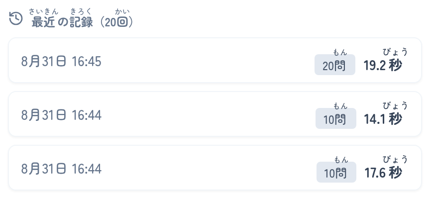

日づけと、もんだいの <ruby>数<rt>かず</rt></ruby>と、<ruby>時間<rt>じかん</rt></ruby>が 出ます。

ベストタイムに 出るのは、ぜんぶ <ruby>正解<rt>せいかい</rt></ruby>で おわった <ruby>回<rt>かい</rt></ruby>だけです。
「<ruby>最近<rt>さいきん</rt></ruby>の<ruby>記録<rt>きろく</rt></ruby>」には、ぜんぶ <ruby>正解<rt>せいかい</rt></ruby>で おわった <ruby>回<rt>かい</rt></ruby>と、<ruby>決<rt>き</rt></ruby>めた <ruby>時間<rt>じかん</rt></ruby>に なって おわった <ruby>回<rt>かい</rt></ruby>が 出ます。
とちゅうで やめた <ruby>回<rt>かい</rt></ruby>や、まちがいを のこしたまま おわった <ruby>回<rt>かい</rt></ruby>は ここには 出ません。

<ruby>時間<rt>じかん</rt></ruby>が 1<ruby>分<rt>ぷん</rt></ruby>を こえる ときは、ここでも 「2<ruby>分<rt>ふん</rt></ruby>5.3<ruby>秒<rt>びょう</rt></ruby>」の ように <ruby>分<rt>ふん</rt></ruby>と <ruby>秒<rt>びょう</rt></ruby>で 出ます。
<ruby>時間<rt>じかん</rt></ruby>を <ruby>決<rt>き</rt></ruby>めた ときと、かけ<ruby>算<rt>ざん</rt></ruby>で だんを えらんだ ときの <ruby>記録<rt>きろく</rt></ruby>の 出かたは、それぞれの <ruby>章<rt>しょう</rt></ruby>に <ruby>書<rt>か</rt></ruby>いてあります。

### <ruby>一発<rt>いっぱつ</rt></ruby>で <ruby>正解<rt>せいかい</rt></ruby>できた <ruby>率<rt>りつ</rt></ruby>と、よく まちがえた <ruby>計算<rt>けいさん</rt></ruby>

青い ところには、力が のびているかどうかが <ruby>分<rt>わ</rt></ruby>かる <ruby>数字<rt>すうじ</rt></ruby>が 出ます。

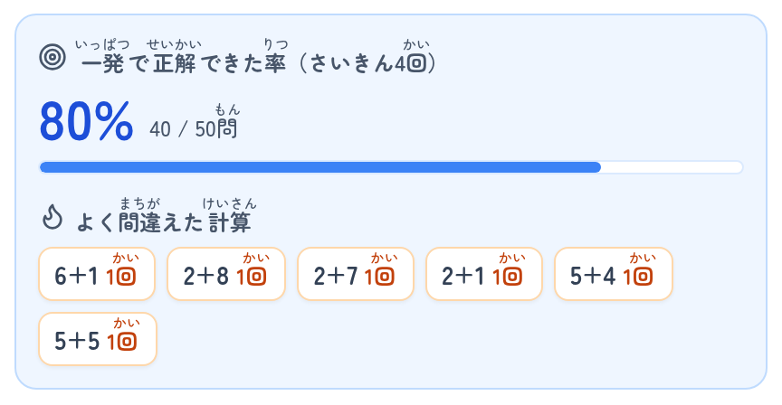

大きな <ruby>数字<rt>すうじ</rt></ruby>が、<ruby>一発<rt>いっぱつ</rt></ruby>で <ruby>正解<rt>せいかい</rt></ruby>できた <ruby>率<rt>りつ</rt></ruby>です。

「<ruby>一発<rt>いっぱつ</rt></ruby>で<ruby>正解<rt>せいかい</rt></ruby>できた<ruby>率<rt>りつ</rt></ruby>」は、1<ruby>回目<rt>かいめ</rt></ruby>の <ruby>答<rt>こた</rt></ruby>えで <ruby>合<rt>あ</rt></ruby>っていた わりあいです。
「すぐ<ruby>判定<rt>はんてい</rt></ruby>」を 入れて いる ときは ぜんぶ <ruby>合<rt>あ</rt></ruby>うまで おわらないので、さいごまで やった <ruby>回<rt>かい</rt></ruby>の <ruby>正解<rt>せいかい</rt></ruby>の <ruby>数<rt>かず</rt></ruby>は いつも <ruby>満点<rt>まんてん</rt></ruby>に なります。
のびているかどうかは、こちらの <ruby>数字<rt>すうじ</rt></ruby>で <ruby>分<rt>わ</rt></ruby>かります。

その 下の 「よく<ruby>間違<rt>まちが</rt></ruby>えた<ruby>計算<rt>けいさん</rt></ruby>」には、<ruby>何度<rt>なんど</rt></ruby>も まちがえた <ruby>式<rt>しき</rt></ruby>が <ruby>多<rt>おお</rt></ruby>い じゅんに 6つまで ならびます。
ここに 出た <ruby>式<rt>しき</rt></ruby>を もう<ruby>一度<rt>いちど</rt></ruby> やってみると、つぎは はやく なります。

とちゅうで やめた <ruby>回<rt>かい</rt></ruby>が ある ときは、「とちゅうでやめた<ruby>回数<rt>かいすう</rt></ruby>」も 出ます。

さいきんの 10<ruby>回<rt>かい</rt></ruby>ぶんから 出すのは、「<ruby>一発<rt>いっぱつ</rt></ruby>で<ruby>正解<rt>せいかい</rt></ruby>できた<ruby>率<rt>りつ</rt></ruby>」だけです。
「よく<ruby>間違<rt>まちが</rt></ruby>えた<ruby>計算<rt>けいさん</rt></ruby>」と 「とちゅうでやめた<ruby>回数<rt>かいすう</rt></ruby>」は、のこって いる ぜんぶの <ruby>記録<rt>きろく</rt></ruby>から <ruby>数<rt>かぞ</rt></ruby>えます。<ruby>手書<rt>てが</rt></ruby>きの <ruby>読<rt>よ</rt></ruby>みまちがいも、まちがいに <ruby>数<rt>かぞ</rt></ruby>えます。

### 【！】<ruby>記録<rt>きろく</rt></ruby>が のこる ばしょ

<ruby>記録<rt>きろく</rt></ruby>は、いま つかっている <ruby>機械<rt>きかい</rt></ruby>の 中だけに のこります。
<ruby>名前<rt>なまえ</rt></ruby>・<ruby>出席番号<rt>しゅっせきばんごう</rt></ruby>・メールアドレスは <ruby>記録<rt>きろく</rt></ruby>して いません。

【！】<ruby>覚<rt>おぼ</rt></ruby>えておいて ほしいこと:

- <ruby>記録<rt>きろく</rt></ruby>は <ruby>機械<rt>きかい</rt></ruby>ごとです。おなじ <ruby>機械<rt>きかい</rt></ruby>を <ruby>何人<rt>なんにん</rt></ruby>かで つかうと、<ruby>記録<rt>きろく</rt></ruby>は 1つに まざります
- 先生が <ruby>学級<rt>がっきゅう</rt></ruby>ぜんいんの <ruby>記録<rt>きろく</rt></ruby>を <ruby>一覧<rt>いちらん</rt></ruby>で 見る <ruby>画面<rt>がめん</rt></ruby>は ありません
- アプリの 中に、<ruby>記録<rt>きろく</rt></ruby>を <ruby>消<rt>け</rt></ruby>す ボタンは ありません。<ruby>消<rt>け</rt></ruby>したい ときは、ブラウザの 「<ruby>閲覧<rt>えつらん</rt></ruby>データの<ruby>削除<rt>さくじょ</rt></ruby>」を つかってください
- iPad で 7日 つかわないと、<ruby>記録<rt>きろく</rt></ruby>が <ruby>消<rt>き</rt></ruby>える ことが あります

## <ruby>紙<rt>かみ</rt></ruby>に <ruby>印刷<rt>いんさつ</rt></ruby>して つかう（先生むけ）

ここは 先生が <ruby>読<rt>よ</rt></ruby>む ところです。ふだん つかう ときは、この <ruby>章<rt>しょう</rt></ruby>を <ruby>読<rt>よ</rt></ruby>まなくても だいじょうぶです。

### 白い マスの ひょうを <ruby>刷<rt>す</rt></ruby>る

ブラウザの メニューから 「<ruby>印刷<rt>いんさつ</rt></ruby>」を えらぶと、マスの ひょうだけが <ruby>紙<rt>かみ</rt></ruby>に 出ます。
上の バーも、<ruby>手書<rt>てが</rt></ruby>きの わくも、ボタンも <ruby>紙<rt>かみ</rt></ruby>には 出ません。

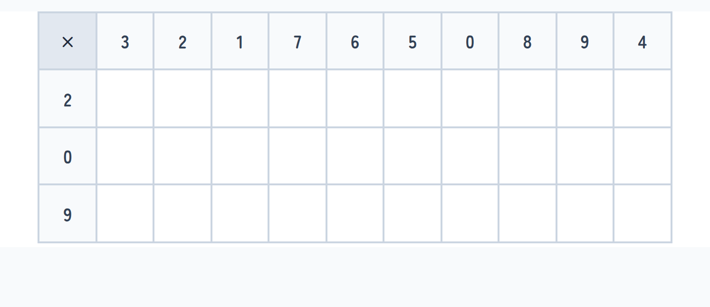

ひょうだけが 出ます。

<ruby>刷<rt>す</rt></ruby>る <ruby>手順<rt>てじゅん</rt></ruby>:

1. もんだいの <ruby>数<rt>かず</rt></ruby>を えらんでください。
2. 「スタート！」を おす まえに、ブラウザの メニューから 「<ruby>印刷<rt>いんさつ</rt></ruby>」を えらんでください。
3. プレビューで、ひょうが 1ページに 入っているかを 見てください。

「スタート！」を おす まえに <ruby>刷<rt>す</rt></ruby>ると、白い プリントとして くばれます。

### <ruby>刷<rt>す</rt></ruby>る まえに たしかめる こと

- <ruby>用紙<rt>ようし</rt></ruby>は A4 の たてむきです
- 1つの マスは 16ミリメートル <ruby>角<rt>かく</rt></ruby>です。100<ruby>問<rt>もん</rt></ruby>（10<ruby>行<rt>ぎょう</rt></ruby>）でも 1ページに 入ります
- とちゅうまで <ruby>答<rt>こた</rt></ruby>えを 入れてから <ruby>刷<rt>す</rt></ruby>ると、入れた <ruby>数<rt>かず</rt></ruby>も、みどりの しるしも いっしょに 出ます

## <ruby>電子黒板<rt>でんしこくばん</rt></ruby>に 大きく うつす（<ruby>提示<rt>ていじ</rt></ruby>モード・先生むけ）

ここも 先生が <ruby>読<rt>よ</rt></ruby>む ところです。ふだん つかう ときは <ruby>読<rt>よ</rt></ruby>まなくても だいじょうぶです。

上の バーの 「大きく<ruby>表示<rt>ひょうじ</rt></ruby>する」を おすと、<ruby>提示<rt>ていじ</rt></ruby>モードに なります。
字も マスも 大きくなり、<ruby>画面<rt>がめん</rt></ruby>ぜんたいに <ruby>広<rt>ひろ</rt></ruby>がります。

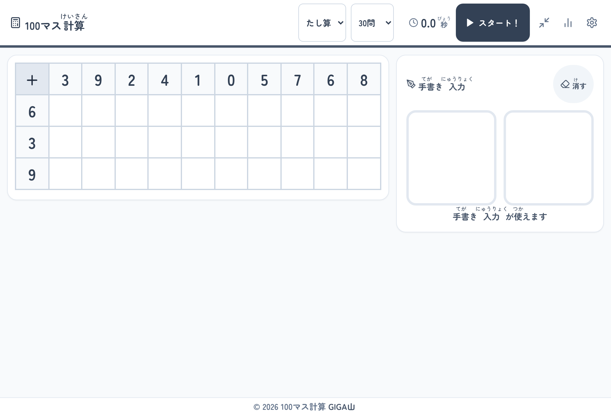

ふだんの <ruby>画面<rt>がめん</rt></ruby>より 字が 大きく なります。

<ruby>提示<rt>ていじ</rt></ruby>モードで できる ことは、つぎの とおりです。

- 65インチから 75インチの <ruby>電子黒板<rt>でんしこくばん</rt></ruby>で、<ruby>教室<rt>きょうしつ</rt></ruby>の いちばん うしろの せきからも マスの <ruby>数字<rt>すうじ</rt></ruby>が <ruby>読<rt>よ</rt></ruby>めます
- もう<ruby>一度<rt>いちど</rt></ruby> おすか、Esc キーで もとに もどります
- キーボードだけでも つかえます。Tab で うつって Enter で えらびます
- <ruby>提示<rt>ていじ</rt></ruby>モードは、はばの <ruby>広<rt>ひろ</rt></ruby>い <ruby>画面<rt>がめん</rt></ruby>の ための ものです。はばが せまい <ruby>画面<rt>がめん</rt></ruby>（たてむきの タブレットや スマートフォン）では、<ruby>手書<rt>てが</rt></ruby>きと ボタンは <ruby>画面<rt>がめん</rt></ruby>の はばいっぱいの ままで、大きさは かわりません
- iPad の Safari は <ruby>画面<rt>がめん</rt></ruby>ぜんたいに <ruby>広<rt>ひろ</rt></ruby>げる しくみに <ruby>対応<rt>たいおう</rt></ruby>していないので、字と マスが 大きく なる ところまでが はたらきます

つかいかたの <ruby>例<rt>れい</rt></ruby>を あげます。

- <ruby>今日<rt>きょう</rt></ruby> やる ところを うつしながら、みんなで いっしょに はじめる
- 先生が <ruby>黒板<rt>こくばん</rt></ruby>の <ruby>画面<rt>がめん</rt></ruby>で といて 見せて、やりかたを みんなで たしかめる
- <ruby>答<rt>こた</rt></ruby>え<ruby>合<rt>あ</rt></ruby>わせの とき、<ruby>正解<rt>せいかい</rt></ruby>の マスと まちがいの マスを みんなで 見る

この アプリは <ruby>名前<rt>なまえ</rt></ruby>も <ruby>出席番号<rt>しゅっせきばんごう</rt></ruby>も あつかっていないので、<ruby>提示<rt>ていじ</rt></ruby>モードで かくす ものは ありません。

## うまく いかない ときは

こまった ときは、ここを 上から さがしてください。

### 「あたらしい ばんが あります」と 出た とき

<ruby>画面<rt>がめん</rt></ruby>の 下に くろい おびで 出ます。おすまで <ruby>切<rt>き</rt></ruby>りかわりません。

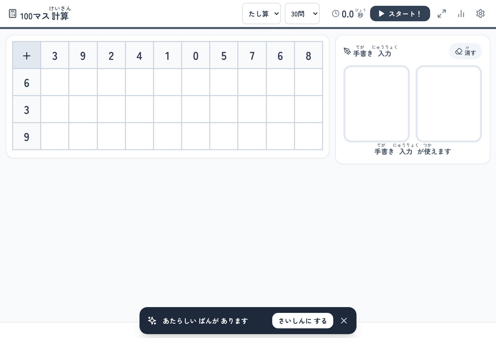

「さいしんに する」を おすと 入れかわります。

おすと <ruby>画面<rt>がめん</rt></ruby>が <ruby>読<rt>よ</rt></ruby>みこみ<ruby>直<rt>なお</rt></ruby>されます。<ruby>計算<rt>けいさん</rt></ruby>の とちゅうで おすと、<ruby>打<rt>う</rt></ruby>ちかけの <ruby>答<rt>こた</rt></ruby>えと タイムが <ruby>消<rt>き</rt></ruby>えて しまいます。
とりくみが おわってから おしてください。

右の ✕ で <ruby>閉<rt>と</rt></ruby>じる ことも できますが、つぎに ひらいた ときに また 出ます。

### <ruby>手書<rt>てが</rt></ruby>きの <ruby>数字<rt>すうじ</rt></ruby>が うまく <ruby>読<rt>よ</rt></ruby>まれない とき

わくいっぱいに、大きく ふとく <ruby>書<rt>か</rt></ruby>いてください。小さく <ruby>書<rt>か</rt></ruby>くと <ruby>読<rt>よ</rt></ruby>みとりにくく なります。

1つの <ruby>数字<rt>すうじ</rt></ruby>は、とちゅうで <ruby>止<rt>と</rt></ruby>まらずに <ruby>書<rt>か</rt></ruby>いてください。<ruby>指<rt>ゆび</rt></ruby>を はなして 0.4<ruby>秒<rt>びょう</rt></ruby>ほど たつと、<ruby>書<rt>か</rt></ruby>きかけでも <ruby>読<rt>よ</rt></ruby>みとりが はしります。

2けたの <ruby>答<rt>こた</rt></ruby>えは、左と 右の わくに 1つずつ <ruby>書<rt>か</rt></ruby>きます。1つの わくに 2つ <ruby>書<rt>か</rt></ruby>くと <ruby>読<rt>よ</rt></ruby>めません。

<ruby>読<rt>よ</rt></ruby>めなかった ときは 「<ruby>数字<rt>すうじ</rt></ruby>がわかりませんでした」と 出て、<ruby>書<rt>か</rt></ruby>いた <ruby>線<rt>せん</rt></ruby>が <ruby>消<rt>き</rt></ruby>えます。そのまま <ruby>書<rt>か</rt></ruby>き<ruby>直<rt>なお</rt></ruby>してください。

### 「AIの じゅんびに <ruby>失敗<rt>しっぱい</rt></ruby>しました」と 出た とき

<ruby>手書<rt>てが</rt></ruby>きの <ruby>読<rt>よ</rt></ruby>みとりの <ruby>部品<rt>ぶひん</rt></ruby>が <ruby>読<rt>よ</rt></ruby>みこめて いません。

1. <ruby>設定<rt>せってい</rt></ruby>を ひらいて、「<ruby>手書<rt>てが</rt></ruby>き<ruby>入力<rt>にゅうりょく</rt></ruby>を<ruby>使<rt>つか</rt></ruby>う」を <ruby>切<rt>き</rt></ruby>ってください。
2. もう<ruby>一度<rt>いちど</rt></ruby> 入れてください。<ruby>読<rt>よ</rt></ruby>み<ruby>直<rt>なお</rt></ruby>しに いきます。

それでも <ruby>直<rt>なお</rt></ruby>らない ときは、「ボタン<ruby>入力<rt>にゅうりょく</rt></ruby>を<ruby>使<rt>つか</rt></ruby>う」を 入れて ボタンで といてください。<ruby>計算<rt>けいさん</rt></ruby>そのものは そのまま つづけられます。

### 入れても みどりや 赤が つかない とき

<ruby>設定<rt>せってい</rt></ruby>の 「すぐ<ruby>判定<rt>はんてい</rt></ruby>」が <ruby>切<rt>き</rt></ruby>れて います。
この <ruby>切<rt>き</rt></ruby>りかたでは、ぜんぶの マスが うまるか、「<ruby>丸<rt>まる</rt></ruby>つけ する」を おすまで <ruby>丸<rt>まる</rt></ruby>つけを しません。

すぐ <ruby>丸<rt>まる</rt></ruby>つけを してほしい ときは、<ruby>設定<rt>せってい</rt></ruby>で 「すぐ<ruby>判定<rt>はんてい</rt></ruby>」を 入れてください。

### マスが 小さくて おしにくい とき

マスの 大きさは、<ruby>画面<rt>がめん</rt></ruby>の はばと たかさに あわせて じどうで きまります。

- もんだいの <ruby>数<rt>かず</rt></ruby>を へらすと、<ruby>行<rt>ぎょう</rt></ruby>が へって、マスは 大きく なります
- マスの 大きさは、よこはばと たてはばの せまい ほうで きまります。<ruby>機械<rt>きかい</rt></ruby>を よこむきに すると よこはばは <ruby>広<rt>ひろ</rt></ruby>く なりますが、たてはばは せまく なるので、<ruby>行<rt>ぎょう</rt></ruby>が <ruby>多<rt>おお</rt></ruby>い ときは たてむきの ほうが 大きい ことも あります
- <ruby>手書<rt>てが</rt></ruby>きか ボタンで 入れると、マスを おさなくても <ruby>答<rt>こた</rt></ruby>えを 入れられます

### 字の <ruby>形<rt>かたち</rt></ruby>が いつもと ちがう とき

この アプリの <ruby>書体<rt>しょたい</rt></ruby>は アプリの 中に 入れて あるので、インターネットに つながっていなくても <ruby>当<rt>あ</rt></ruby>たります。
ただし、つぎの 2つの ときは、<ruby>機械<rt>きかい</rt></ruby>の 中に ある べつの <ruby>書体<rt>しょたい</rt></ruby>で 出ます。どちらも うごきに もんだいは ありません。

- はじめて ひらいて、<ruby>書体<rt>しょたい</rt></ruby>を <ruby>読<rt>よ</rt></ruby>みこみおわるまでの <ruby>少<rt>すこ</rt></ruby>しの あいだ
- この <ruby>書体<rt>しょたい</rt></ruby>に 入っていない めずらしい 字を 出す とき

### <ruby>記録<rt>きろく</rt></ruby>が きえて しまった とき

iPad で 7日 いじょう つかっていないと、Safari が <ruby>記録<rt>きろく</rt></ruby>を <ruby>消<rt>け</rt></ruby>す ことが あります。
ホーム<ruby>画面<rt>がめん</rt></ruby>に 入れておくと <ruby>消<rt>き</rt></ruby>えにくく なります。

ブラウザの 「<ruby>閲覧<rt>えつらん</rt></ruby>データの<ruby>削除<rt>さくじょ</rt></ruby>」を した ときも <ruby>消<rt>き</rt></ruby>えます。

### <ruby>画面<rt>がめん</rt></ruby>が まっしろに なった とき

1. いちど タブを <ruby>閉<rt>と</rt></ruby>じて、もう<ruby>一度<rt>いちど</rt></ruby> ひらいてください。
2. <ruby>直<rt>なお</rt></ruby>らない ときは、インターネットに つながる ところで、ブラウザの 「<ruby>再読<rt>さいよ</rt></ruby>み<ruby>込<rt>こ</rt></ruby>み」（<ruby>丸<rt>まる</rt></ruby>い やじるしの しるし）を おしてください。
3. それでも <ruby>直<rt>なお</rt></ruby>らない ときは、キーボードの Ctrl キーと Shift キーを おした まま、R キーを おしてください（Chromebook と Windows の ばあい）。ブラウザが、のこして ある ものを つかわずに <ruby>読<rt>よ</rt></ruby>みこみ<ruby>直<rt>なお</rt></ruby>します。

どの やりかたでも、<ruby>記録<rt>きろく</rt></ruby>は <ruby>消<rt>き</rt></ruby>えません。

### それでも なおらない ときは

まず、この アプリを おしえてくれた 先生や、学校の <ruby>情報<rt>じょうほう</rt></ruby>の <ruby>係<rt>かかり</rt></ruby>の 先生に きいてください。
学校の ネットワークの せっていで うごかない ことが あるので、いちばん はやく わかります。

それでも わからない ときは、この ページの 下に ある <ruby>問<rt>と</rt></ruby>い<ruby>合<rt>あ</rt></ruby>わせ先から しらせてください。

## かけ<ruby>算<rt>ざん</rt></ruby>で れんしゅうする だんを えらぶ（7のだん だけ など）

かけ<ruby>算<rt>ざん</rt></ruby>では、れんしゅうする だんを えらべます。「7のだん だけ」「6・7・8のだん だけ」のように、おぼえたい だんに しぼって とりくめます。
えらべるのは、<ruby>計算<rt>けいさん</rt></ruby>の しゅるいが かけ<ruby>算<rt>ざん</rt></ruby>の ときだけです。とりくんでいる あいだは えらべません。

### だんを えらんで はじめる

かけ<ruby>算<rt>ざん</rt></ruby>を えらんでから、上の バーに 出る ボタンで えらびます。

1. 上の バーで、<ruby>計算<rt>けいさん</rt></ruby>の しゅるいを 「かけ<ruby>算<rt>ざん</rt></ruby>」に してください。もんだいの <ruby>数<rt>かず</rt></ruby>の 右どなりに 「だん: ぜんぶ」ボタンが 出ます。

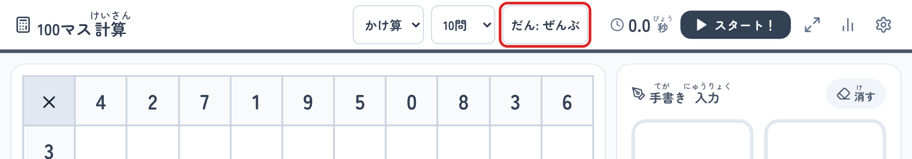

赤い わくの ボタンです。

2. 「だん: ぜんぶ」を おしてください。「だんを えらぶ」の まどが 出ます。
3. れんしゅうする だんを おしてください。えらんだ だんは 青く なって、チェックの しるしが つきます。もう<ruby>一度<rt>いちど</rt></ruby> おすと はずれます。

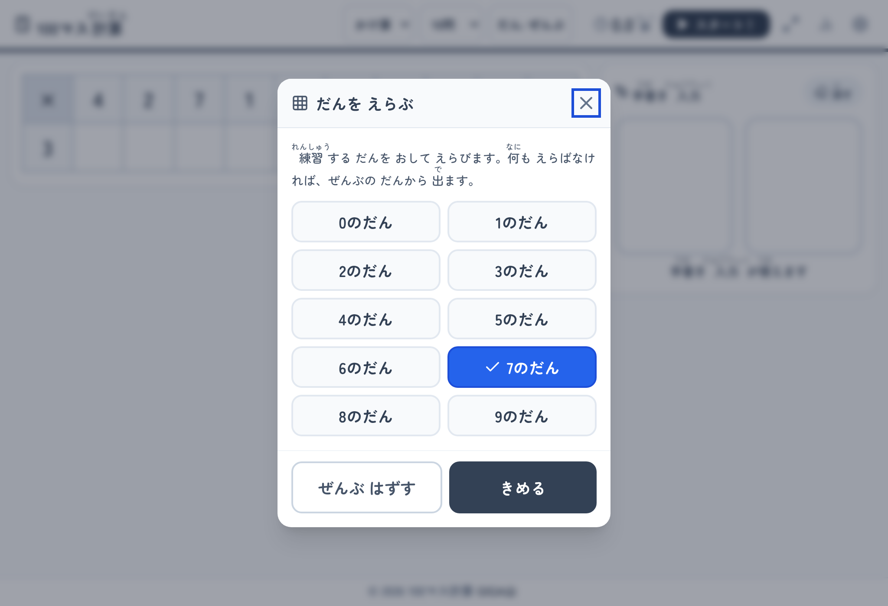

7のだんを えらんだ ところです。

4. 「きめる」を おしてください。左に、えらんだ だんだけが ならんだ ひょうが 出ます。

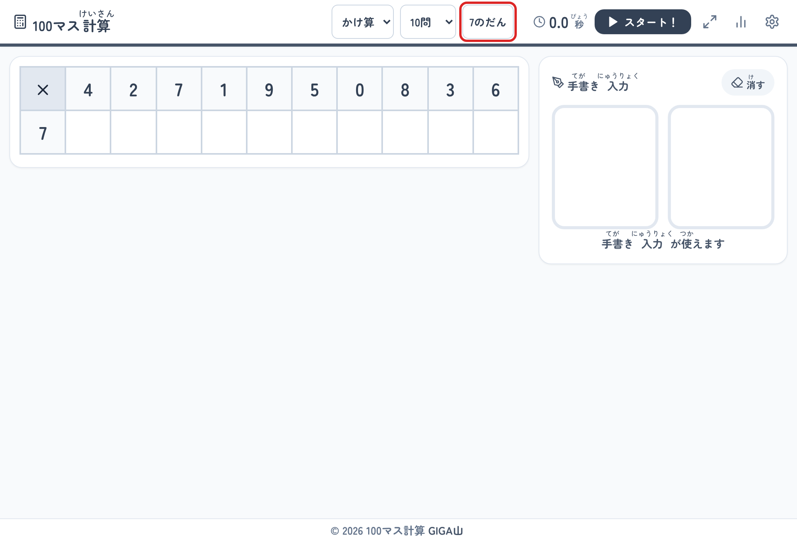

左が 7だけに なり、ボタンは 「7のだん」に かわります。

5. 「スタート！」を おして はじめてください。

【！】<ruby>覚<rt>おぼ</rt></ruby>えておいて ほしいこと:

- <ruby>何<rt>なに</rt></ruby>も えらばずに 「きめる」を おすと、ぜんぶの だんから 出ます。もとに もどしたい ときも こう します
- 「ぜんぶ はずす」を おすと、えらんだ だんを いちどに はずせます
- <ruby>右上<rt>みぎうえ</rt></ruby>の ✕ を おすと、えらびかたを かえずに まどを <ruby>閉<rt>と</rt></ruby>じます
- えらんだ だんは、アプリを ひらき<ruby>直<rt>なお</rt></ruby>すと 「ぜんぶ」に もどります

### えらんだ だんの <ruby>数<rt>かず</rt></ruby>と、もんだいの <ruby>数<rt>かず</rt></ruby>の きまり

「きめる」を おすと、もんだいの <ruby>数<rt>かず</rt></ruby>は 「えらんだ だんの <ruby>数<rt>かず</rt></ruby> × 10<ruby>問<rt>もん</rt></ruby>」に かわります。おなじ だんを 2<ruby>行<rt>ぎょう</rt></ruby> 出さない ためです。

- 7のだん だけを えらぶ。10<ruby>問<rt>もん</rt></ruby>（1<ruby>行<rt>ぎょう</rt></ruby>）に なります
- 6・7・8のだんを えらぶ。30<ruby>問<rt>もん</rt></ruby>（3<ruby>行<rt>ぎょう</rt></ruby>）に なります
- それより <ruby>多<rt>おお</rt></ruby>い もんだいの <ruby>数<rt>かず</rt></ruby>は、うすい <ruby>色<rt>いろ</rt></ruby>に なって えらべません
- <ruby>少<rt>すく</rt></ruby>なく する ことは できます。3つ えらんで 20<ruby>問<rt>もん</rt></ruby>に すると、えらんだ 3つの うち 2つが 出ます

ボタンの 字は、えらんだ だんに あわせて かわります。

- 1つから 3つ えらんだ とき。「7のだん」「6・7・8のだん」のように 出ます
- 4つ いじょう えらんだ とき。「だん: 4こ」のように、えらんだ <ruby>数<rt>かず</rt></ruby>が 出ます
- <ruby>何<rt>なに</rt></ruby>も えらんで いない とき。「だん: ぜんぶ」と 出ます

<ruby>計算<rt>けいさん</rt></ruby>の しゅるいを たし<ruby>算<rt>ざん</rt></ruby>や <ruby>引<rt>ひ</rt></ruby>き<ruby>算<rt>ざん</rt></ruby>に かえると、ボタンは <ruby>消<rt>き</rt></ruby>えます。かけ<ruby>算<rt>ざん</rt></ruby>に もどすと、えらんだ だんは そのまま のこって います。

### だんを えらんだ ときの <ruby>記録<rt>きろく</rt></ruby>

だんを えらんで ぜんぶ <ruby>正解<rt>せいかい</rt></ruby>で おわった <ruby>回<rt>かい</rt></ruby>は、「<ruby>最近<rt>さいきん</rt></ruby>の<ruby>記録<rt>きろく</rt></ruby>」に 「7のだん」の しるしつきで 出ます。
ベストタイムには 入りません。ぜんぶの だんから 出した ときの タイムと くらべられなく なる ためです。

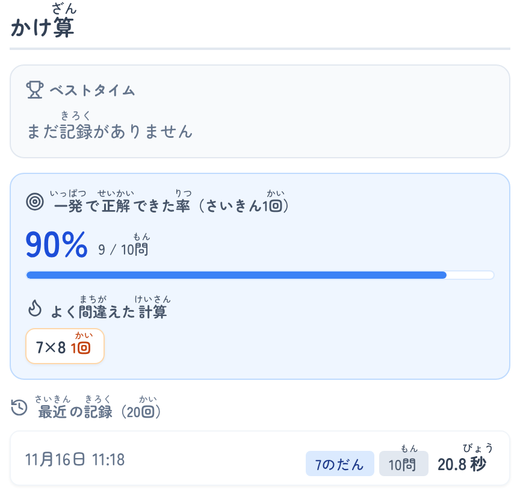

「7のだん」と 出ます。ベストタイムには 入って いません。

「<ruby>一発<rt>いっぱつ</rt></ruby>で<ruby>正解<rt>せいかい</rt></ruby>できた<ruby>率<rt>りつ</rt></ruby>」と 「よく<ruby>間違<rt>まちが</rt></ruby>えた<ruby>計算<rt>けいさん</rt></ruby>」には、だんを えらんだ <ruby>回<rt>かい</rt></ruby>も 入ります。

## <ruby>時間<rt>じかん</rt></ruby>を <ruby>決<rt>き</rt></ruby>めて とりくむ・タイマーを かくす（<ruby>設定<rt>せってい</rt></ruby>）

<ruby>設定<rt>せってい</rt></ruby>で、<ruby>時間<rt>じかん</rt></ruby>の つかいかたを 2つ かえられます。「<ruby>時間<rt>じかん</rt></ruby>を<ruby>決<rt>き</rt></ruby>める」は 「2<ruby>分<rt>ふん</rt></ruby>で <ruby>何問<rt>なんもん</rt></ruby> できるか」を ためす ときに、「タイマーを かくす」は <ruby>時間<rt>じかん</rt></ruby>が 気に なって あせって しまう ときに つかいます。
どちらも、はじめは <ruby>切<rt>き</rt></ruby>れて います。

### <ruby>時間<rt>じかん</rt></ruby>を <ruby>決<rt>き</rt></ruby>めて、<ruby>何問<rt>なんもん</rt></ruby> できるか ためす

<ruby>決<rt>き</rt></ruby>めた <ruby>時間<rt>じかん</rt></ruby>に なると、とちゅうでも そこで おわります。みんなで いっしょに はじめると、みんな <ruby>同<rt>おな</rt></ruby>じ ときに おわります。

1. 上の バーの 右はしに ある はぐるまの しるしを おして、<ruby>設定<rt>せってい</rt></ruby>を ひらいてください。
2. 「<ruby>時間<rt>じかん</rt></ruby>を<ruby>決<rt>き</rt></ruby>める」の 右の えらぶ ところを おして、<ruby>時間<rt>じかん</rt></ruby>を えらんでください。なし・1<ruby>分<rt>ぷん</rt></ruby>・2<ruby>分<rt>ふん</rt></ruby>・3<ruby>分<rt>ぷん</rt></ruby>・5<ruby>分<rt>ふん</rt></ruby>・10<ruby>分<rt>ぷん</rt></ruby>から えらべます。

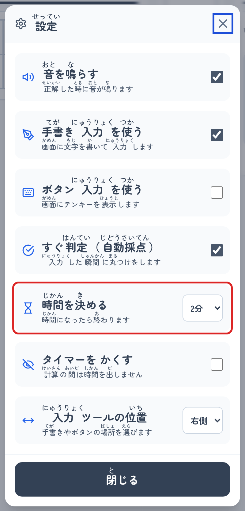

赤い わくの ところで えらびます。ここでは 2<ruby>分<rt>ふん</rt></ruby>に しました。

3. 下の 「<ruby>閉<rt>と</rt></ruby>じる」を おしてください。上の バーの <ruby>時間<rt>じかん</rt></ruby>の ところが 「のこり 2<ruby>分<rt>ふん</rt></ruby>」に かわります。

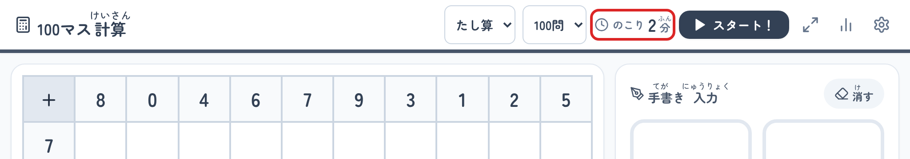

はじめる <ruby>前<rt>まえ</rt></ruby>は、<ruby>決<rt>き</rt></ruby>めた <ruby>時間<rt>じかん</rt></ruby>が 出ます。

4. 「スタート！」を おしてください。「のこり 1<ruby>分<rt>ぷん</rt></ruby>23<ruby>秒<rt>びょう</rt></ruby>」のように、のこりの <ruby>時間<rt>じかん</rt></ruby>が へって いきます。

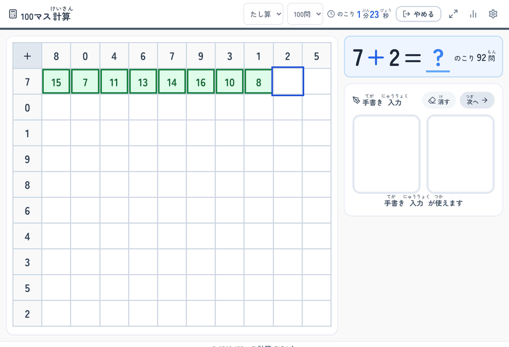

上の バーに のこりの <ruby>時間<rt>じかん</rt></ruby>が 出ます。

5. <ruby>時間<rt>じかん</rt></ruby>に なると、「<ruby>時間<rt>じかん</rt></ruby>です！よく<ruby>頑張<rt>がんば</rt></ruby>ったね！」と 出て おわります。その 下に 「2<ruby>分<rt>ふん</rt></ruby> で 23<ruby>問<rt>もん</rt></ruby> できました」のように、<ruby>正解<rt>せいかい</rt></ruby>できた <ruby>数<rt>かず</rt></ruby>が 出ます。

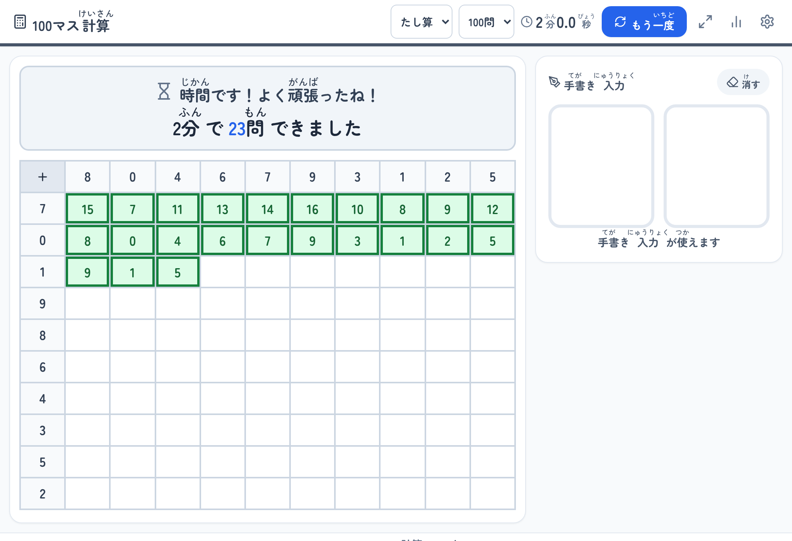

2<ruby>分<rt>ふん</rt></ruby>で 23<ruby>問<rt>もん</rt></ruby> できた ところです。

【！】<ruby>覚<rt>おぼ</rt></ruby>えておいて ほしいこと:

- <ruby>時間<rt>じかん</rt></ruby>に なる <ruby>前<rt>まえ</rt></ruby>に ぜんぶ とけた ときは、いつもどおり 「クリア！」と かかった <ruby>時間<rt>じかん</rt></ruby>が 出ます
- とりくんでいる あいだは、<ruby>時間<rt>じかん</rt></ruby>を かえられません。えらぶ ところが うすい <ruby>色<rt>いろ</rt></ruby>に なります
- <ruby>決<rt>き</rt></ruby>めた <ruby>時間<rt>じかん</rt></ruby>は この <ruby>機械<rt>きかい</rt></ruby>に のこります。やめたい ときは 「なし」に もどしてください
- もんだいの <ruby>数<rt>かず</rt></ruby>は、<ruby>時間<rt>じかん</rt></ruby>の 中で とききれない くらい <ruby>多<rt>おお</rt></ruby>めに えらんで おくと、<ruby>何問<rt>なんもん</rt></ruby> できたかを くらべやすく なります

### <ruby>時間<rt>じかん</rt></ruby>を <ruby>決<rt>き</rt></ruby>めた ときの <ruby>記録<rt>きろく</rt></ruby>

<ruby>時間<rt>じかん</rt></ruby>に なって おわった <ruby>回<rt>かい</rt></ruby>は、<ruby>記録<rt>きろく</rt></ruby>の <ruby>画面<rt>がめん</rt></ruby>の 2つの ところに 出ます。

- 「<ruby>時間<rt>じかん</rt></ruby>を<ruby>決<rt>き</rt></ruby>めたときの さいこう」。その <ruby>時間<rt>じかん</rt></ruby>で いちばん <ruby>多<rt>おお</rt></ruby>く <ruby>正解<rt>せいかい</rt></ruby>できた <ruby>数<rt>かず</rt></ruby>が、「2<ruby>分<rt>ふん</rt></ruby>: 23<ruby>問<rt>もん</rt></ruby>」のように 出ます。1<ruby>分<rt>ぷん</rt></ruby>と 2<ruby>分<rt>ふん</rt></ruby>は べつに ならびます
- 「<ruby>最近<rt>さいきん</rt></ruby>の<ruby>記録<rt>きろく</rt></ruby>」。「2<ruby>分<rt>ふん</rt></ruby>で 23<ruby>問<rt>もん</rt></ruby>」のように 出ます

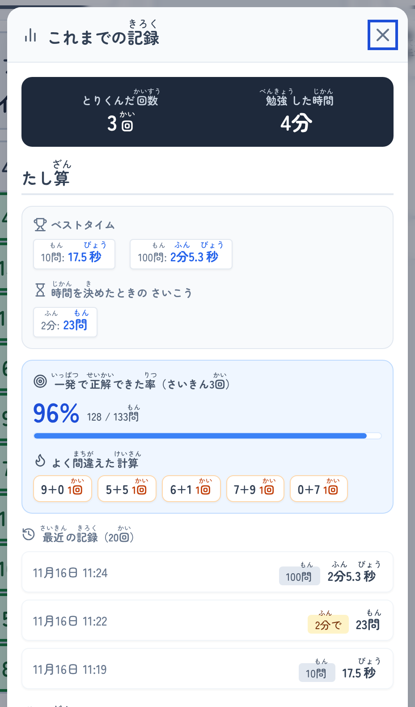

ベストタイムの 下に 「さいこう」が 出ます。

【！】<ruby>覚<rt>おぼ</rt></ruby>えておいて ほしいこと:

- 1<ruby>問<rt>もん</rt></ruby>も <ruby>正解<rt>せいかい</rt></ruby>できなかった <ruby>回<rt>かい</rt></ruby>は、どちらにも 出ません
- 「さいこう」は <ruby>計算<rt>けいさん</rt></ruby>の しゅるいごとです。もんだいの <ruby>数<rt>かず</rt></ruby>が ちがっても、<ruby>同<rt>おな</rt></ruby>じ <ruby>時間<rt>じかん</rt></ruby>なら 1つに まとまります
- かけ<ruby>算<rt>ざん</rt></ruby>で だんを えらんだ <ruby>回<rt>かい</rt></ruby>は、「さいこう」には 入りません。「<ruby>最近<rt>さいきん</rt></ruby>の<ruby>記録<rt>きろく</rt></ruby>」には 出ます
- <ruby>時間<rt>じかん</rt></ruby>に なる <ruby>前<rt>まえ</rt></ruby>に 「やめる」で やめた <ruby>回<rt>かい</rt></ruby>は、とちゅうで やめた <ruby>回<rt>かい</rt></ruby>に なります

### とりくんでいる あいだ タイムを 出さない（タイマーを かくす）

<ruby>設定<rt>せってい</rt></ruby>の 「タイマーを かくす」を 入れると、はじめる <ruby>前<rt>まえ</rt></ruby>と とりくんでいる あいだ、上の バーに <ruby>時間<rt>じかん</rt></ruby>が 出なく なります。
おわると、いつもどおり かかった <ruby>時間<rt>じかん</rt></ruby>が 出ます。<ruby>記録<rt>きろく</rt></ruby>にも のこります。

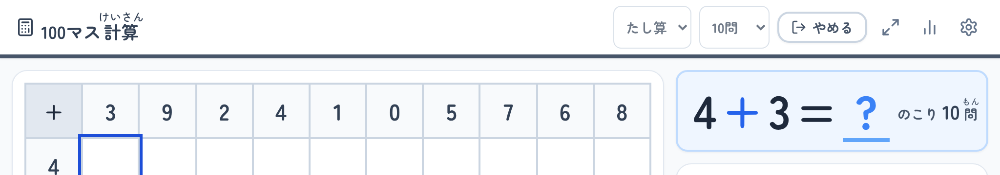

とりくんでいる あいだも、<ruby>時間<rt>じかん</rt></ruby>が 出て いません。

【！】<ruby>覚<rt>おぼ</rt></ruby>えておいて ほしいこと:

- <ruby>時間<rt>じかん</rt></ruby>は 出て いないだけで、はかって います
- 「<ruby>時間<rt>じかん</rt></ruby>を<ruby>決<rt>き</rt></ruby>める」と いっしょに 入れると、「のこり」の <ruby>時間<rt>じかん</rt></ruby>も 出ません。<ruby>時間<rt>じかん</rt></ruby>に なると、そこで おわります
- とりくんでいる あいだでも、<ruby>設定<rt>せってい</rt></ruby>を ひらけば 入れたり <ruby>切<rt>き</rt></ruby>ったり できます
